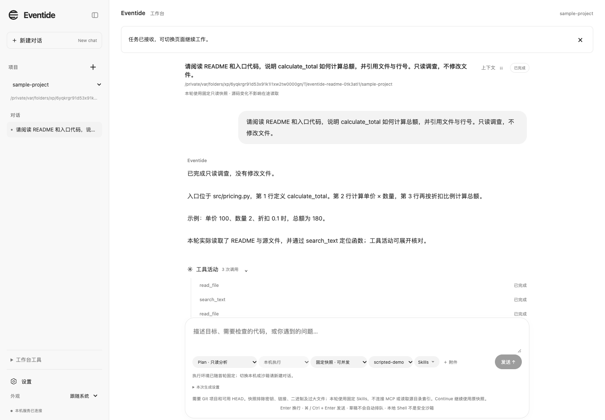
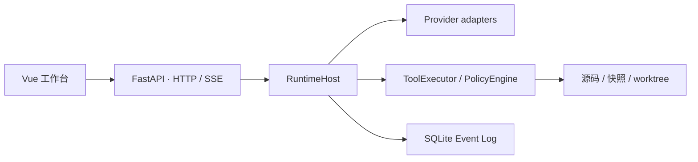

# Eventide

[](https://github.com/Zesadv7/eventide/actions/workflows/ci.yml)
[](LICENSE)

**一个本地运行的代码 Agent 工作台：理解项目、隔离修复、独立验收、人工采纳。**

Eventide 通过 Web 对话协助你阅读代码和定位问题，支持在独立 Git 工作副本中修改代码。
修复交付使用开始时固定的检查验收候选补丁，最后由你审阅并决定是否采纳。
执行过程、工具结果和验收证据保存在本地，可在页面刷新后继续查看。
进度连接断开时，页面显示重连倒计时；联网或返回页面后会自动尝试接回最新进度，不会重复提交已经接收的任务。

[快速开始](#快速开始) · [用户指南](docs/user-guide.md) · [架构设计](docs/architecture.md) · [发布版本](https://github.com/Zesadv7/eventide/releases)

## 工作台预览



*真实工作台界面，使用临时示例项目和 ScriptedProvider 演示数据，未调用真实模型；不作为模型效果证据。*

## 核心能力

| 能力 | 你可以做什么 |
|---|---|
| 理解与定位代码 | 带行号读取、直接/正则文本搜索（正则依赖本机 ripgrep）、上下文行与来源内容哈希；可选副本独立索引、结构切分与命中源码核对 |
| 并发与隔离修复 | 同项目创建多个会话，使用只读快照或会话独立 worktree，查看排队与运行状态 |
| 验收与人工采纳 | 固定验收条件，失败后有界修正，回查失败证据，查看补丁并明确采纳 |
| 文件改动与撤销 | 精确唯一匹配编辑，歧义不改文件；版本绑定续页；红绿逐行对比与按次撤销，冲突时拒绝覆盖 |
| 扩展与执行追溯 | 按需加载固定版本 Skills、接入 MCP 工具，处理权限审批，查询事件和恢复检查点 |
| 兼容性核对 | 启动时核对前后端契约版本；不匹配时明确提示升级并阻止写入，网络故障不误报为版本问题 |

| 可读故障报告 | 从已保存事件事实生成中文摘要：发生什么、停在哪、完成了什么、哪些结果未知、下一步；JSON/Markdown 可下载，不自动外发 |
| 摘要与证据对照 | 并排查看已保存摘要版本、覆盖范围、约束与未证实判断，点开对应原始消息；缺失记录、截断和无法核对的来源明确提示 |
| 旁枝提问 | 主任务运行时单独做只读调查，查看实际执行副本和已保存的报错；只有明确点击回传才进入主任务，终态后的答案不自动续跑 |
| 恢复详情 | 服务重启后自动续跑的任务展示唯一后继与当前状态；用户停止、预算停驻、未知工具结果分类呈现，操作只复用既有停止/继续端点，不提供自动重跑 |

此外支持项目/安装级偏好记忆、调用用量与预算记录，以及可选 Docker 执行沙箱。
模型遇到可恢复的网络错误、限流或不完整流时，主任务同一步内最多尝试 10 次；等待释放模型名额，每次消费单独记录并受原预算约束。页面显示原因、下一尝试与倒计时，刷新不会重置等待。认证、余额不足和协议错误保留诊断并停止，工具不会因半截回答而执行。
功能的启用方式和组合限制见 [用户指南](docs/user-guide.md)。

## 快速开始

需要 **Python 3.10+、Git 和 [uv](https://docs.astral.sh/uv/)**，并准备可用模型的 API Key。
用户运行时不需要 Node.js；默认本地执行也不需要 Docker。

```bash
git clone https://github.com/Zesadv7/eventide.git
cd eventide
uv sync --locked
uv run eventide-server --host 127.0.0.1 --port 8000
```

打开 **http://127.0.0.1:8000**，进入工作台：

1. 在设置中填写 Provider、模型、Base URL 和 API Key；可显式检查连接后保存。
2. 添加服务电脑上的本地项目目录，创建对话。
3. 首次体验建议选择 **Plan** 模式，发送一个只读任务，例如：

   > 请阅读 README 和入口代码，说明项目如何启动，并引用相关文件与行号。不要修改文件。

需要自动修改时，可选择独立 worktree；需要固定检查和补丁采纳流程时，进入“修复交付”。
独立 worktree 首次创建要求 Git 项目有可信 HEAD、源目录干净。

支持 Anthropic Messages、OpenAI-compatible Chat Completions 和 OpenAI Responses。
设置页的“模型能力与验证记录”显示端点、能力来源和目录版本，分开标示配置保存、连接检查和工具验证；未知能力不会标成已支持，连接通过也不代表工具验证通过。已接收任务保存能力引用，续做不随默认配置变化。
具体模型的工具与参数支持按能力校验；页面保存的密钥在本地状态中加密存储，不要写入 Git。

其他安装方式、状态备份及 [Docker 部署](docs/user-guide.md#docker-部署与执行沙箱) 见用户指南。

## 从调查到补丁采纳

添加项目 → 配置模型 / Skills → 代码调查 → 独立副本修改 → 固定检查验收 → 审阅补丁 → 人工采纳。

修复交付最多验收三次候选；达到轮次上限仍未通过、超限或出现未知工具结果时停止并保留证据。
验收绑定对应补丁和源码检查点，不能用修改前的结果证明新候选通过。
独立验收的长日志在配额内脱敏保存，可按 stdout/stderr 分页回查；超额或过期会明确提示。
采纳前再次检查源项目与候选，不自动提交、合并或推送。

## 设计概览



- **执行**：Python / asyncio / FastAPI / Pydantic 2；工具调用统一经过契约校验和权限策略。
- **界面**：Vue 3 / TypeScript / Vite / Router / Pinia，由 FastAPI 同源托管构建产物。
- **状态**：SQLite WAL 与追加式事件记录；队列、审批、用量和恢复复用同一 Runtime。
- **扩展**：Skills、官方 MCP SDK；FTS5 / RRF 检索，可选本地语义模型与重排。

MCP 调用中超时、断连或取消导致结果未知时，页面明确提示并停驻，不自动重发可能已执行的操作。

详细的所有权、并发、恢复及取舍见 [架构](docs/architecture.md) 和 [设计决策](docs/decisions.md)。

## 验证与当前边界

工程验证覆盖后端、类型与静态检查、Vue 组件、真实 API 浏览器旅程、真实 Docker 和安装包分发。
最近一次实现验收见 [GitHub Actions](https://github.com/Zesadv7/eventide/actions/runs/39644102821)，
覆盖率为 **93.03%**；工程门禁与真实模型效果分别报告。

历史 GLM 冻结任务回归为 **42/60**，另一组独立理解/定位任务为 **22/24**。
两者对应不同任务集与冻结条件，不能合并成通用成功率，也不代表后续增量提高了模型效果。
完整条件、历史失败和提高预算后的真实项目结果见 [实验记录](docs/architecture.md#真实模型实验记录)。

使用前需要了解：

- 当前面向本机、单用户、单服务进程。新接收任务在进程意外退出后，可从已确认的执行边界自动续做，保留原模型、工作副本与预算；旧历史、待审批、未知工具结果和源码变化仍停驻。正常关闭服务已记为取消的任务暂不自动恢复。
- 模型仍可能给出错误事实、引用或不完整修复，固定测试的覆盖范围也需要人工核对。
- worktree 隔离代码修改；本地 Shell 仍以当前用户权限运行。
- 可选 Docker 沙箱关闭工具网络，禁用 Skills / MCP / worker / 索引；候选通过文本补丁导出后手动处理。
- 用量区分 reported / estimated / unknown；没有价格时费用未知，目前没有已证实的 Token 或费用改善。

当前 master 包含 0.5.0 发布后的文本搜索、验收证据回查、红绿对比与内置文件撤销等增量。
下载 [0.5.0 Release](https://github.com/Zesadv7/eventide/releases/tag/v0.5.0) 时以该版本说明为准。

## 深入文档

| 文档 | 内容 |
|---|---|
| [用户指南](docs/user-guide.md) | 页面操作、模型与状态、Skills、恢复、部署和开发命令 |
| [架构](docs/architecture.md) | 执行链、事件存储、并发隔离、交付及实验依据 |
| [API 契约](docs/api-contract.md) | HTTP / SSE、请求身份、错误和前后端约定 |
| [设计决策](docs/decisions.md) | 长期取舍及已被替代的设计 |
| [失败案例](docs/failure-cases.md) | 可追溯的失败、原因、修复和复验 |

开发评测和交付示例见 [examples/](examples/)，维护约定见 [AGENTS.md](AGENTS.md)。

## License

[MIT](LICENSE)

本次 Maka 借鉴升级在独立候选分支实施，完整进度与尚未交付项见 [升级状态](AGENTS.md#maka-upgrade-status)。目前聊天支持运行中补充（在下一次模型请求前加入，迟到只留记录）和 Agent 主动提问（最多3题，选择/文本回答、刷新保留、同问题重复提交去重；回答不会替代工具审批），并提供“待处理”页面汇总待回答问题、可读审批、最近失败和待采纳候选，可按项目筛选并在刷新后保留范围；记忆保存回执可直接在聊天中查看和撤销。自动恢复、工具发现、原生隔离等仍有后续切片，不能把已通过的定向测试当整套升级验收。

工具活动现在能直接展开本地源码读取和文本搜索证据：文件版本、实际读取行范围、是否还有下一页，以及搜索命中和上下文、未搜索或跳过的文件数量。文件后来发生变化不会改写历史证据，页面会提醒它仅代表当时的读取；没有结构化信息的旧记录保留原始结果。此切片已验证实际 API、刷新和窄屏展示，完整升级仍按 AGENTS.md 的进行中事项推进。

聊天里的“模型输入记录”可按尝试查看消息/工具数量、规则是否被截断、工具目录和输入版本指纹，并翻阅较早记录。它记录的是交给模型适配器的输入，不是供应商收件凭证；字符数也不是Token数。重试前撤销记忆时，下一次输入会使用新的指纹。页面按需读取，不额外调用模型；旧历史没有清单时明确显示未记录。

聊天中的工具目录现在读取本次运行开始执行时保存的目录与加载记录，可搜索名称/来源，查看参数契约和加载失败。无MCP的普通本地任务同样能查工具；Plan只展示实际开放的工具。显示“已加载”不等于已获执行授权，目录页不直接执行工具。

恢复详情页会保留原运行身份；点击继续后可进入新运行，网络中断再点不会创建第二个续做任务。若同一会话已有更新的运行，旧页面会要求刷新。页面上的步骤数和工具调用数是已记录进度，不代表工作已经验收成功。

本机普通Shell/Skill脚本的脱敏输出现在支持按调用身份分页回读；配额截断、过期或丢失会明确显示。容器采集与后台任务仍待接入。

自动恢复现在也覆盖正常关闭服务后重新启动：符合原恢复条件的任务会接着做，已经明确停止、预算停驻或结果不明的任务仍按各自原因处理。旧运行和续做运行分别保留记录；不会把旧任务改写成一直没有中断。


主动提问目前覆盖本机源目录/工作副本及 Plan 主任务；子任务、交付 Writer 和 Docker 任务不提供该工具。等待期间释放模型名额，停止后不续跑。服务重启后保留原问题为关闭或过期记录，自动重建等待尚未实现；明确答复原问题后才能继续的要求不会变成默认答案。


只读任务图可通过 Run API 创建、显式开始和停止：依赖节点完成后自动补位，节点使用主任务实际执行副本的只读快照并共享父预算；图节点与旁枝合计最多4个。写入节点、自动整合和独立验收尚未接入任务图，旧节点重启后不重复执行。

聊天中的“协作任务图”可先保存最多16个只读调查任务及前后依赖，再明确点击开始；开始后按依赖自动接续，页面展示等待、执行、停止中和完成结果。刷新可回看已保存方案，结果按普通文字显示，并可进入对应子任务运行记录；写入协作和候选整合仍待后续切片。


同一轮模型请求中的本机内置读取、文件枚举和文本搜索可并行执行，全服务共用最多4个读取名额；写入、Shell、自定义工具与交互工具仍按顺序执行并隔开读取批次。工具活动分别显示等待、执行中、失败和未执行，结果按原请求顺序交给模型。停止会撤销尚未启动的读取，并等已经开始的读取真正结束后保存结果。Docker和原生后端的不同工具实现暂保持串行。


同一轮的内置读取、目录枚举和文本搜索可并行，全服务最多同时执行4项；写入和交互工具保持顺序。停止会撤销排队项并等待已启动工作收尾，结果按原请求顺序交给模型。命令日志不会被误当源码进展，连续相同失败仍按原规则停驻。

聊天执行环境新增“原生隔离 · 实验性文件工具”：明确选择后只在会话固定的独立工作副本中读写，支持只读和允许修改副本两种权限；后端或策略不可用时直接说明原因。页面展示实际探测结果，探测到程序不代表隔离已验证。本切片尚未完成真实macOS/Linux内核验收，不作为可信隔离承诺；Shell、Skills、MCP、检索、旁枝和网络工具暂未开放。Docker仍可独立选择。读取保留既有版本续页和长行契约；修改只生成候选，仍须人工采纳。


原生文件写入的成功回执只代表本次核对观察点：内容原子发布后会重开目标并核对身份和字节；若已观察到编辑器替换文件或改动内容，显示结果未知并停驻，保留双方实际改动，不自动重写。核对不保证文件此后永久不变。


恢复详情页可对停驻的内置文件写入做只读核查：用写前保存的原调用、预期字节和目标外Git可见工作区证据核对实际文件。证据齐全的未终态崩溃任务可接着做，原写入不会重放；已终态任务核清后仍需明确点击继续。当前仍为原字节、其他文件变化、旧记录缺证据以及Shell/MCP结果会保留待判断，不把“现在没变化”说成“从未执行”。

