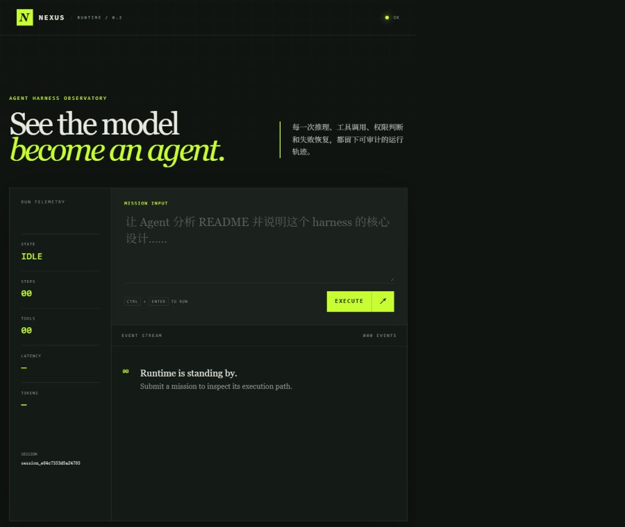

# Eventide

[](https://github.com/Zesadv7/eventide/actions/workflows/ci.yml)

Eventide v0.4 是面向软件工程项目的 Workspace Agent Runtime。RuntimeHost 管理 Workspace 与 Session，运行事实统一写入 Event Log；消息、运行状态和模型上下文都从日志投影生成。CLI、HTTP API 和现有 Web 控制台使用同一执行主链。

主要能力：

- async-first Agent loop，同一 Session 串行；显式 Plan 固定快照和独立写入 worktree 可在同一项目并发，直接源目录执行仍独占；
- 事件驱动的有界任务计划、依赖校验与 Git worktree 管理；
- Anthropic Messages、OpenAI-compatible Chat Completions 和 OpenAI Responses API；
- `ALLOW / ASK / DENY` 权限决策与 CLI、Web 一次性审批；
- MCP stdio 与 Streamable HTTP 工具发现和调用；
- Workspace 级 Skill 发现与按需加载；
- Workspace 级混合知识检索（Hash/API embedding + FTS5 trigram + RRF）；
- 有界 Researcher / Reviewer 只读协作，可选 tree-sitter 代码结构切块；
- worktree 写入交付、独立命令验收与显式补丁采纳，可选 Docker Shell 执行；
- SQLite 追加式 Event Log、持久上下文 checkpoint 与 JSONL 导出；
- 从运行日志派生的隐私受限 trace，可选 OpenTelemetry 导出；
- 中断检测、停驻与用户主动 Continue，不自动重放工具副作用；
- scripted provider 离线评测与真实模型 live eval；
- FastAPI、SSE 事件流和原生中文 Web 控制台。



## 环境要求

- Python 3.10 及以上；
- 推荐使用 [uv](https://docs.astral.sh/uv/) 管理环境；
- 只有连接真实模型时才需要 API Key，帮助命令、单元测试和离线评测不需要网络或密钥。

## 安装

使用 uv：

```bash
uv sync --extra dev
```

不使用 uv：

```bash
python -m venv .venv

# Windows
.\.venv\Scripts\Activate.ps1

# Linux / macOS
source .venv/bin/activate

python -m pip install -e ".[dev]"
```

## 五分钟运行

无需 API Key 即可检查 CLI、运行测试和离线评测：

```bash
uv run python -m eventide --help
uv run pytest -q
uv run eventide eval evals/smoke.yaml
uv run eventide rag eval evals/retrieval.yaml
```

任务级评测套件在一次性 Git 沙箱中运行每条用例，判分只看沙箱文件与 Git 证据：

```bash
uv run eventide eval evals/tasks.yaml
```

全部评测用例都在各自的一次性 Git 项目和独立状态根中运行；未声明 `workspace` 时使用空项目，不读取或修改启动目录的源码。离线与 live 均关闭外部 MCP。每次评测保留临时产物目录、逐用例源码与数据库，包括失败结果；摘要显示报告路径，JSON 的 `artifact_dir` / `report_path` 及逐用例 `artifact_dir` 可定位证据。Python 开发接口的临时产物不会自动删除；Web 离线自检的产物存入服务状态根中专用的 evaluations 目录。

默认输出人类可读摘要：任务完成率、平均步数、失败原因分布和失败用例；加 `--json` 打印完整报告。报告中的 `task_completion_rate` 是通过用例占比，`failure_reasons` 汇总失败原因，live 模式另汇总输入/输出 tokens。离线结果是 scripted 回归冒烟（`regression_smoke: true`），不代表真实模型的任务完成率。

### 一个可以复现的工程闭环

```bash
uv run python -m examples.rag_repair
```

示例在临时 Git 工作区创建一个折扣计算 bug 和 3 条 unittest，先确认测试失败，再通过真实 Runtime 工具检索带行号的约定、读取代码。达到两步预算后 Session 停驻；关闭并重新打开 Host，使用 Continue 恢复，执行预设补丁、拦截一次越界读取，再运行测试。最后独立子进程再次验收退出码，并确认测试文件未被修改。成功时 JSON 的 `passed` 为 true，`before_exit_code=1`、`after_exit_code=0`，临时文件自动清理。

这展示的是**可检索、可审计、可恢复、可验证的执行机制**。决策和补丁由 ScriptedProvider 预设，不是模型自主修复能力的证明；路径校验也不是操作系统沙箱。真实模型能力需要另外显式运行 live 评测，不能把这个结果写成真实模型成功率。

启动 Web 控制台：

```bash
uv run eventide serve --host 127.0.0.1 --port 8000
```

浏览器打开 `http://127.0.0.1:8000`。页面是两栏布局：左侧导航选择 Workspace 和工作（Session），其余为工作记录正文；顶栏的任务计划、工具、详情、用量四个胶囊按钮按需弹出悬浮详情卡。左上角“添加工作区”可注册这台电脑上的已有项目目录，成功后直接进入该 Workspace；左侧工作列表可通过条目上的“⋯”或右键重命名、归档/恢复，只有没有运行历史的空记录可硬删除；“显示已归档”用于找回归档记录。输入区右下角可以为本次 Run 选择模型，“配置”按钮打开连接弹窗，填写 Provider、默认模型、Base URL 和 API Key，可以先检查连接，再保存并应用。Provider 配置由同一 Host 的所有工作区共用；逐 Run 模型选择只覆盖本次请求，不改全局默认值。配置写入状态根的 `runtime.sqlite`，API Key 使用同目录 `secret.key` 或 `EVENTIDE_SECRET_KEY` 加密。

默认状态根：Windows 为 `%LOCALAPPDATA%\Eventide`，macOS 为 `~/Library/Application Support/Eventide`，Linux 为 `$XDG_STATE_HOME/eventide`（未设置时 `~/.local/state/eventide`）。`EVENTIDE_STATE_DIR` 可覆盖；相对路径相对于启动工作目录解析。状态目录独占：`serve` 运行期间，使用同一状态根的另一 CLI/Host 会明确报错，首版没有跨进程客户端协议。

v0.2 历史可在关闭旧进程后显式导入；源数据库保持只读，导入在新库中要么全部成功、要么不写入：

```bash
uv run eventide migrate-v02 /path/to/project/.nexus/nexus.db --workspace /path/to/project
```

省略数据库路径时，默认读取目标 Workspace 下的 `.nexus/nexus.db`。导入保留 Session、消息、Run、事件以及未含密钥的 Provider 配置；旧密文依赖旧状态根的密钥，出于安全原因不会复制，需要在 Web 的模型配置中重新填写 API Key。重复 Session/Run 身份会在导入前拒绝，不覆盖现有历史。测试和离线评测不需要 API Key。

## 容器运行

仓库提供根目录 `Dockerfile`（uv 基础镜像、非 root 用户、不含 `.env` 与任何状态根）和演示用的 `docker-compose.yml`：

```bash
docker build -t eventide .
docker run --rm -p 127.0.0.1:8000:8000 -v eventide-state:/data/eventide -v eventide-workspace:/workspaces/demo eventide
```

或使用 compose 演示（状态根与演示工作区均为命名卷）：

```bash
docker compose up --build
```

- 状态根挂载在 `/data/eventide`（镜像内已通过 `EVENTIDE_STATE_DIR` 指定该绝对路径），保存 `runtime.sqlite`、`secret.key` 和 `host.lock`，必须用卷持久化。演示工作区挂载在 `/workspaces/demo`；接入真实项目时把这一项换成 bind mount 即可，注意容器内非 root 用户（UID 1000）需要对挂载目录有读写权限。
- 容器内 `serve` 绑定 `0.0.0.0`，宿主侧端口映射保持 `127.0.0.1` 边界，与本机运行的默认行为一致。
- 如果重建容器时既没有持久化状态根卷，也没有固定 `EVENTIDE_SECRET_KEY`，之前通过 Web 保存的 API Key 将无法解密，需要在设置中重新填写。
- Docker 转发可能使服务看到非回环的连接来源。可在启动时通过 `EVENTIDE_LOCAL_PROXY_PEERS` 配置实际测得的精确转发 IP（多个地址用逗号分隔）；默认空，不接受网段、主机名或通配符。配置后，来自这些地址的管理请求还必须使用 `localhost`／回环 IP 的 Host 与完全匹配的 Origin。宿主端口必须继续只发布到 `127.0.0.1`，不能将此配置用于公网服务。
- 满足上述本机访问条件后，在 Web 的“添加项目”中填写容器内路径，例如 `/workspaces/demo`，模型和 Skills 也由页面管理。不要在服务运行期间另启 CLI Host 操作同一状态根；状态根锁会拒绝第二个 Host。服务入口禁用 Uvicorn 转发头处理，不从 `X-Forwarded-For` 等请求头授予本机权限。

首次启动可从宿主访问 `http://127.0.0.1:8000/healthz`，再用 `docker compose logs eventide` 查看该请求的实际来源 IP；将这一精确地址设为 `EVENTIDE_LOCAL_PROXY_PEERS` 后重新执行 `docker compose up -d`。不同 Docker 网络的地址可能不同，不能照抄别人的网关。镜像默认工作目录为可写的 `/workspaces/demo`，不会将程序自身 `/app` 登记成用户项目。

2026-10-16 已在 Apple Silicon Mac 的 Docker Desktop 上完成镜像构建、实际 Compose 启动、同源管理、Vue 全部资源哈希和容器重建后的会话／配置／项目文件恢复验证。测试使用一次性命名卷和假配置，未发送模型请求。可复现的分发检查为 `python tests/container_smoke.py --image eventide:validation`；先自行构建对应镜像，脚本只清理自己的临时容器和卷。

容器只是部署形态：Eventide 的权限策略与本地 Shell 执行器仍以容器用户身份运行，不构成操作系统沙箱（与 ADR-005、ADR-012 一致）。

## Project 与执行副本

Project 将一个本地源码项目与它的 Git worktree 工作副本聚合起来；Workspace 继续表示具体目录，Session 仍固定绑定原 Workspace 和工作目录。注册 Git worktree 时，服务按真实 Git common directory 关联同一项目，并登记主 checkout；独立 clone 即使 remote 相同也不合并。非 Git 目录各自作为项目。

`GET /api/projects`、`/api/projects/{id}`、`/api/projects/{id}/workspaces` 和 `/api/projects/{id}/sessions` 可查询项目及其全部执行副本、对话。现有添加工作区接口继续使用，响应增加 `project_id`、`source_workspace_id`、`kind`；不接受客户端重绑既有对话。创建受管 worktree 会自动注册副本，交付 Writer 与源项目共享 Project 身份，新 Run 的接收及开始事件固定记录该归属。

首次升级自动补齐身份关系，既有 Workspace、Session、Run 和事件保持原身份及原文；旧路径已丢失或无法验证 Git 时保留为独立项目，后续不静默改绑。源项目还有执行副本时不能移除注册；任何有会话或 Run 执行引用的 Workspace 仍不能移除。直接源目录仍串行；显式 Plan 快照和写入 worktree 可在同一项目并发，持久接收与有界调度见下文。

## 同项目 Plan 快照并发

在 Vue 对话页选择“Plan · 只读分析”及“固定快照 · 可并发”，即可创建隔离调查；页面显示本轮快照状态，停止只影响当前 Run。HTTP 创建 Run 时传 `execution_target: "snapshot"` 和 `mode: "plan"`，或 Python 使用 `RunRequest(..., mode="plan", execution_target="snapshot")`，即可让不同 Session 在同一个项目上同时调查。省略 `execution_target` 仍使用原来的 `source` 执行方式；此切片不改变旧 CLI。一个 Session 同时只能执行一个 Run。Run 和 Session 查询返回 `execution`，说明实际使用源目录还是哪个固定快照。

接收时短暂独占源 Workspace，从当前 Git 可见源码（包含未提交改动）创建持久副本，复制前后验证 checkpoint。快照要求有可信 Git HEAD；最多 2,000 个候选文件、10 MiB 文本，单文件最多 1 MiB；忽略、密钥、链接、二进制与过大文件排除，排除数在 `execution.skipped` 显示。模型运行期间不占源目录锁，其他 Session 的快照和直接源操作可以继续；新快照不能在正在直接写源目录时创建。

快照使用固定 Skills 和快照内文件工具，暂不接外部 MCP、源目录知识索引或嵌套 worker，也没有 Shell/写文件/Skill 脚本权限。Continue 和重启后的人工恢复沿用原副本，源代码后来变化不改变该次调查；副本丢失或内容被改则拒绝运行。快照产物保存在状态根，不能手工清理后期待恢复；文件只读位与摘要校验不等于操作系统沙箱。持久排队及全局并发容量限制仍由 P3 后续实现。

显式把状态目录放进项目内部时，源码指纹只排除实际运行数据库及其 WAL/SHM/journal、租约/密钥和该状态根的附件、固定 Skill 包、快照产物中的未跟踪文件；普通源码、项目 `skills/`、其他数据库和已跟踪文件仍检查漂移。状态目录不能等于 Workspace 根；默认状态目录位于项目外，写 worktree 仍要求外置状态。新指纹保存排除策略版本；旧内置状态的停驻任务若口径不同会保守拒绝 Continue，需要人工检查后放弃旧恢复并新建任务，不能自动换基线。

## 同项目写入对话与交付协调

HTTP Run 使用 `execution_target: "worktree"`，Python 使用 `RunRequest(..., execution_target="worktree")`，可让同项目的不同 Session 使用独立 Git 工作副本。首个 Run 要求源目录干净并有可信 HEAD；接收前后检查源码没有变化。首次副本准备结束后释放源目录，后续模型执行与文件工具使用各自副本。`execution.execution_workspace_id` 标识实际工作目录，Session 的 Workspace/cwd 逻辑绑定仍保留。

同一 Session 后续消息和 Continue 都复用首次 worktree，保留未采纳修改；重启后仍从持久事实恢复。已绑定 worktree 的 Session 不能切回 source 或 snapshot；需要新副本时创建新 Session。创建后源代码变化不改变已有副本。接收后副本被外部修改会在开始前拒绝，停驻后的修改也会阻止 Continue；未知工具结果隔离实际副本，放弃恢复不能绕过。源项目和其他副本仍可使用。

项目 Skill 启用配置沿用逻辑源身份，正文与资源从实际副本冻结；文件、指令、检索索引及只读 worker 都使用实际副本，不静默回读源目录。副本暂不连接外部 MCP。共享 Git 元数据操作和 Shell/Skill 命令按项目协调，但模型请求与普通文件工具仍可并发。本机 Shell 仍具有本机权限，worktree 不提供操作系统沙箱。

Delivery 的写入与独立验收期间不再整轮占住源目录；准备、副本比对和人工采纳短暂协调源目录与 Git。验收期间源变化会使结果失效，采纳前再次检查双方源码。含 Run 引用的副本禁止删除；创建失败或取消留下的受管副本保留可检查，不自动清除。此处还没有自动合并或有界多轮修复，旧 CLI/Python 的直接源操作继续兼容。

### 运行队列与并发

单个服务默认最多持有 4 个根 Run、同时发送 2 次模型请求、接收 20 个等待 Run。`GET /api/queue` 查询全局容量、已接收队列和正在执行的精确身份；Run/Session 的 `queued` 状态表示尚未执行，可使用原停止接口取消。排队取消保留任务目标供 Continue 使用，不产生模型尝试或 Token 预留。容量满时返回 429，拒绝的请求不会写入 Run 或用户消息；同 Session 已有工作、源正在直接执行时返回 409。

Python `run()` / `continue_session()`、HTTP 和 Delivery Writer 共用同一接收及调度路径；Python 仍等待最终 `RunResult`。忙源请求直接拒绝，调用者稍后显式重试，不再在无持久身份时后台等待。队列只接收已经冻结参数、Skills、执行位置与 checkpoint 的工作：源忙时不能准备新副本；缺少可信 Git checkpoint 的直接源任务不能排队。原本空闲时的非 Git 直接运行保留，但不能验证外部源码漂移或 Continue。

等待任务只保留 Session 身份，不持有源码/副本执行锁；实际派发前重验固定源码，漂移则失败且不调用模型。空出的名额按接收提交顺序分配给当前可以执行的任务。停止会等待正在运行的工具收尾后才释放名额；服务重启将未结束任务停驻，用户检查后 Continue，不自动重放。主 Agent、摘要、worker 和连接探测共用 2 个模型名额；重试等待、工具与子任务等待均不占模型名额。连接探测使用真实后台控制 Run，计入 Run 与 UTC 当日预算，不占 Agent 根任务名额，也不计入当前项目；embedding 接线另在 C 阶段处理。


## Workspace 与 Continue

```bash
uv run eventide workspace add /path/to/project
uv run eventide workspace list
uv run eventide workspace show ws_example
uv run eventide run "检查项目测试" --workspace /path/to/project --cwd packages/api --json
uv run eventide chat --workspace ws_example
uv run eventide serve --workspace /path/to/project
uv run eventide continue session_example --json
uv run eventide abandon session_example --json
uv run eventide plan show session_example --json
uv run eventide export run_example ./eventide-run.jsonl
```

省略 `--workspace` 时使用当前目录；Git 仓库内的子目录归一化到仓库根，非 Git 目录也可运行。每个 Session 固定绑定一个 Workspace 和其中的 working directory；`run/chat --cwd` 可显式选择，若 `--workspace` 本身传入仓库子目录则默认把该子目录作为 cwd。Shell 与文件工具从 cwd 运行，并把它作为文件访问边界；Git checkpoint 仍覆盖整个 Workspace。根目录 `AGENTS.md` 加入模型上下文（最多 4,000 字符），`mcp.json` 和 `skills/` 按 Workspace 加载。生产基础工具为 `bash/read_file/write_file/edit_file/glob/compact/read_tool_result/todo_write`；发现有效 Skill 时再增加只读的 `load_skill`。旧教学 Agent、文件式任务图、teammate/cron、模拟 MCP 和全局工具注册表已删除，Python 入口统一为 `eventide.host.RuntimeHost` 与 `eventide.store.RuntimeStore`。`migrate-v02` 的历史数据库导入与现有 HTTP/SSE 契约继续保留。`workspace remove <id>` 只移除没有 Session 的注册记录，不删除项目文件。

Host 重启会把未结束的 run 标记为 `interrupted`，Session 显示为 `parked`；单次 run 用尽步数预算（默认 30 步，`EVENTIDE_MAX_STEPS` 可调）时同样停驻，可由用户 Continue 继续，不会整轮失败；运行中被用户停止时也会先记录 checkpoint 再停驻，因此同样可以继续。服务崩溃后重启时，Host 会按 Git 可见路径的修改时间与删除情况判断崩溃之后工作区有没有被动过：没被动过就补记 checkpoint，工作记录仍可 Continue；查到改动则记录改动过的文件（最多 20 条），此时只能放弃恢复或先自行核对工作区。存在任务计划时，同一条进行中的任务连续占用步数（默认 12 步，`EVENTIDE_TASK_MAX_STEPS` 可调，设为 `0` 关闭）也会停驻并点名该任务，避免一条卡住的任务烧光整个 run 的预算；这是 run 内的软上限，不改变 `max_steps` 这个硬上限，Continue 后重新计数。Continue 必须由用户发起；它检查 Git HEAD、暂存/未暂存改动及未跟踪文件是否匹配最后可信 checkpoint，并拒绝存在未知 Bash、MCP 或写工具结果的历史。通过检查后创建新 turn/run，旧用户消息不会重复写入，未完成的只读调用会标记为 abandoned。非 Git、未提交过的 Git 仓库、包含 submodule 的项目或缺少可信 checkpoint 时不支持 Continue。检查范围是 Git 可见源码，不覆盖 ignored 文件或外部系统状态。Continue 无法通过时，可以使用 Web 的“放弃恢复”或 `eventide abandon` 保留历史并解除停驻；结果未知的工具不会被视为成功或重新执行。

上下文摘要只覆盖已结束的 turn，原始事件不变；达到模型输出上限的残缺摘要不会保存为 checkpoint。Prompt、模型正文和工具参数不会因日志展示限长而在执行前被静默截断；工具始终使用 Provider 返回的原始参数，审计事件中的敏感字段使用脱敏副本。预算按 system、messages 和完整工具目录的序列化请求计算。超过 12,000 字符的单条工具结果会先在模型请求中变成带 run/call 引用的头尾预览，模型可用只读 `read_tool_result(run_id, call_id, offset, limit)` 分页取回任意区间；TodoWrite 的历史整表参数也会在请求侧省略，只保留下方当前计划。canonical Event Log、审计导出和工作记录保留执行器返回的结果与完整计划。Shell 采用有界流式采集：stdout/stderr 各保留最多 25,000 字节的头尾，明确报告省略字节数，丢弃的中段无法通过 `read_tool_result` 恢复；非 Shell 的结果分页保留完整 canonical 内容。摘要之后仍超预算时，当前 turn 内较早的工具结果会继续折叠为占位串（保留最近三条预览或原文），并记录 `context.trimmed`。仍无法在预算内保留时返回 `context_overflow`，不会静默丢弃当前交互。预算单位保持为序列化请求的字符数。模型输出达到 `max_tokens` 被截断且没有工具调用时，run 以 `failed` 结束并提示提高 `EVENTIDE_MAX_TOKENS`，不会静默报成功。

HTTP 保留原有 session/run/approval/SSE 路由，新增 Workspace 注册、查询、无会话记录移除、项目会话列表、session/messages 和 Session Run History 查询。`POST /api/sessions` 可传 `workspace_id` 和 Workspace 内的 `working_directory`；空请求继续绑定启动项目根目录。Vue「会话管理」可重命名、归档、恢复和确认删除空会话。修改固定读取版本，冲突后需显式刷新；结果未知时页面保留原请求供重试，刷新不重复执行。`PATCH /api/sessions/{id}` 可设置显式标题或归档状态；PATCH/DELETE 均要求 Idempotency-Key 和 expected_metadata_hash，服务控制会话不能修改；默认列表隐藏已归档 Session，传 `include_archived=true` 可查看。`DELETE /api/sessions/{id}` 只删除没有 Run 或事件历史的空 Session，有历史的工作记录必须归档。Run History 默认返回最近 100 条，可用 `limit`（最多 200）和 `before=<run_id>` 向前翻页；Web 提供“加载更早记录”。`GET /api/runs/{id}/export` 流式下载 canonical JSONL；CLI `export` 默认拒绝覆盖已有文件，显式 `--force` 才替换。`POST /api/sessions/{id}/continue` 先完成恢复校验并持久化新 Run，再返回 `202`、`run_id` 和 `status=accepted`；验证失败返回 409，执行继续通过 Run 查询与 SSE 观察。同 Session 或正在直接运行的源 Workspace 冲突返回409；已完成冻结但缺根名额的请求进入持久队列，满额429。Web 长任务状态显示已观察到的模型步数、正在执行的任务和运行时长，并提供按 Run 停止；不虚构无法由事件证明的完成百分比。另有只读的能力自省（`GET /api/workspaces/{id}/capabilities`）、运行设置（`GET /api/runtime/settings`）以及 Session 附件上传、清单、下载和删除接口，见[接口契约](docs/api-contract.md)。

普通 Run 与 Continue 都先把身份、运行模式、模型选择、用户消息或恢复事实及 checkpoint 作为一个事务提交，再返回 HTTP 202；因此收到 202 后可以立即查询和停止，即使后台执行尚未开始，目标也不会丢失。接收期间同样占用 Workspace，阻止其他入口与配置切换插入。Continue 继承 Plan 的只读限制；相同 Provider 和 Base URL 下继承原模型，切换 Provider 或 Base URL 后使用当前默认模型。Agent 模式的自动审批只授权原 Run，Continue 恢复为 Auto。

摘要有持久节流：同一 Session、Provider 和模型下，已经认领的相同完成前缀不再次自动请求，失败、取消或未采用也不会清空依据。后续完成内容至少新增 4,000 个序列化字符、距上次认领至少 60 秒，才允许再次摘要；首次摘要没有新增内容门槛，`compact` 也不绕过节流。60 秒是请求资格判断，不会阻塞等待。有效 checkpoint 优先复用；节流后仍无法通过既有结果折叠满足硬上下文预算时，明确以 `context_overflow` 失败，拒绝继续调用主模型。节流不代表消费已发生：未派发的请求不补用量，实际摘要仍按真实尝试记账。

摘要调用与主模型请求使用相同的超时和有限重试。已收到的摘要用量计入 Run，即使摘要残缺、没有采用或随后上下文溢出；失败请求未返回的账单用量不能由本地推测。可选 `EVENTIDE_RUN_TOKEN_LIMIT` 为每个 Run 的输入与输出 Token 总量软上限，默认 `0` 关闭：在下一次模型请求前检查已观测用量，达到时以 `token_budget` 停驻。单个响应可能越过上限，Continue 开启新预算；它不是硬性费用限额。

附件按完整 Session ID 的 SHA-256 存入状态根 `attachments/~<hash>/`，内部记录再次验证精确归属。事件引用是已使用的依据，即使文件中的 used 缓存未写成功，也不能通过 API 删除。旧目录仅在能够确认安全身份时只读兼容；不自动搬移、覆盖或删除历史附件。

## 可选代码结构检索与观测

默认检索继续使用轻量窗口。安装 `uv sync --extra dev --extra code` 后，可显式开启 tree-sitter：

```bash
uv run --extra code eventide rag build --workspace /path/to/project --code-structure --force
uv run --extra code eventide rag eval evals/retrieval.yaml --code-structure --json
```

Python、JavaScript、TypeScript/TSX 按函数、类和嵌套符号切块，保留准确行号；大符号仍受 800 字符窗口限制。缺依赖、语法损坏或不支持语言时回退原窗口并报告原因。切块模式和 parser 版本纳入索引指纹，变化需要 `--force`。当前内置 16 题语料在窗口与结构模式下均全部命中，尚没有质量提升证据；结构模式用于增加定位精度，后续用同语料对照评价。

`trace` 从 canonical 事件派生脱敏的 Run、模型、摘要、工具与父子关系，不新建事实库：

```bash
uv run eventide trace run_example ./trace.json
uv run --extra telemetry eventide trace run_example --otel-endpoint http://127.0.0.1:4318/v1/traces
```

默认离线 JSON；只有显式 endpoint 才发送 OTLP HTTP，依赖 `telemetry` extra。出口只含固定类别、哈希身份、状态、耗时和已观测用量，不发送正文、参数、工具结果或密钥。跨父子费用汇总使用各 Run 自身模型事件，避免把父 inclusive 用量再叠加子用量；失败/重试未返回用量会标为不完整，不推测费用。供应商未返回 usage 时不再伪造零值；缓存和推理明细作为可选字段保留，不重复加到总量。Anthropic 的总输入按未缓存、缓存读取和缓存创建之和归一化，其他供应商按其总输入口径处理。Vue用量页使用独立尝试账本及固定价格快照；兼容的Run已观测软限仍独立保留，完整U1/U3验收见AGENTS.md。

## 受控只读 Agent 协作

设置 `EVENTIDE_WORKERS=1` 后，有可信 Git HEAD 的 Workspace 增加 `delegate_readonly(tasks)`。模型可委派 Researcher 或 Reviewer；每批最多 2 个并发子任务，每个 Run 最多 4 个，子任务不能再委派。默认每个子 Run 最多 8 步、4,000 已观测 Tokens、60 秒，并从父 Run 剩余 Token 软预算中分配；父级用量包含子任务，子 Run 自身用量另可查询，汇总时不能重复相加。

子任务读取当前 Git 可见源码的独立 UTF-8 快照，包括未提交和未跟踪源码，范围遵守 Session cwd；排除链接、秘密配置、二进制和过大文件，并记录排除数量。源码变动或快照超过容量限制时拒绝委派。子任务只开放 `read_file/glob/compact/read_tool_result`，不连接 MCP、不使用自定义处理器、不继承父聊天记录。报告必须为结构化 JSON，文件与行号必须存在于快照；通过验证仅表示引用合法，Researcher/Reviewer 的结论仍是模型声明。

父任务停止或超时会等待所有子任务结束后清理快照。独立的子 Session 默认归档，父事件记录身份、源码 hash、关系和用量，子 Run 可通过既有查询/导出接口检查；子 Session 不接受普通 Run、Continue 或附件。源码快照和工具白名单是执行边界，不是 OS 沙箱。

```bash
EVENTIDE_WORKERS=1 uv run eventide run "委派 Researcher 定位调用链，并让 Reviewer 复查潜在问题"
uv run eventide eval evals/workers.yaml
```

## 隔离修复、独立验收与显式采纳

`deliver` 将写入 Worker 放入受管 worktree，原项目必须从干净的 Git HEAD 开始；用户已有修改会在创建 checkout 前拒绝。流程分开执行和验收，模型的“完成”回复不构成测试通过。

```bash
uv run eventide deliver --workspace /path/to/project prepare repair
# prepare 返回 delivery_id 和 checkout 路径
uv run eventide deliver run delivery_example "修复问题，保持固定测试和配置不变" --local
uv run eventide deliver verify delivery_example --check "python -B -m unittest discover -s tests" --local
uv run eventide deliver show delivery_example
# 审阅 show 返回的 patch 文件和检查结果后，显式采纳
uv run eventide deliver apply delivery_example
```

每次 Run / Verify 都必须显式选择 `--local` 或 `--container-image <已存在的 Linux 镜像>`。Local 使用本机权限；容器只接管 Shell，文件工具仍在隔离 worktree 中执行，模型请求在 Host，Writer 不连接 MCP。容器不自动拉镜像，仅支持本机 Docker endpoint；默认限制网络、权限、进程、CPU/内存，验收挂载只读、Writer 挂载可写，UID 1000 需要对应权限。Docker bind 不挂载 worktree 外的 Git common dir，因此容器中的 Git 命令可能不可用。容器配置会随 Workspace 后续 Run/Continue 保存，不因重启或新 Session 静默退回 Local。`--container-image ""` 明确拒绝。

验收通过现有 ToolExecutor/PolicyEngine 运行显式检查，保存真实退出码、超时、输出与检查时源码 checkpoint。默认保护测试、CI、项目/依赖配置、锁文件和秘密文件，`prepare --protect <glob>` 可增加保护；这些文件需要变更时应人工处理。检查期间变更源码、修改测试、来源被用户改动、补丁被篡改或 checkout 已变化都会拒绝采纳。补丁以 SHA-256 绑定状态根文件和 canonical 事件；`apply` 再核对最新通过的检查及来源、checkout，精确应用，不自动暂存、提交或合并分支。失败产物与历史保留。

容器超时/停止会等待实际清理；无法确认时保留 `tool.outcome_unknown`，不写伪完成。可能仍在写的 Workspace 被阻止继续执行和采纳，重启也保留该边界。需要检查 Docker 状态并保留原产物；可从未受影响的原项目建立新的交付 worktree，不能用“放弃恢复”绕过未知状态。同步文件工具被多次停止时同样保持所有权直到线程结束；已得到真实结果会落库，再停驻。

无需 Key 可复现整个交付闭环：

```bash
uv run python -m examples.delivery_repair
uv run eventide eval evals/engineering.yaml
```

示例包含失败 → worktree 修复 → Host 重启 → 独立验收 → 审阅用补丁 → 显式采纳 → 原项目复验。三组工程评测覆盖折扣、TTL 缓存、配置合并，共 20 条固定 unittest：先确认基线失败，保存原测试及哈希，模型结束后检查测试未改，再用独立 Python 进程运行原版测试；模型正文不参与验收。离线 scripted 的 3/3 只证明执行机制，真实质量需同一套件显式 `--live`，报告包含基线/验收退出码、测试完整性与已观测用量。固定测试和 Local 检查不是抵御恶意代码的安全沙箱。

## Git worktree 管理

旧 worktree 能力已经迁入 Workspace 控制面，不再依赖 `.tasks`、`.worktrees` 或导入时的全局目录：

```bash
uv run eventide worktree --workspace /path/to/project create review-fix
uv run eventide worktree --workspace /path/to/project list
uv run eventide worktree --workspace /path/to/project keep review-fix
uv run eventide worktree --workspace /path/to/project remove review-fix
```

`create` 默认从已提交的 `HEAD` 创建，也可传 `--ref <已有分支/tag/commit>`；不复制原工作区的未提交修改。分支使用 `codex/<workspace_id>/<name>`，checkout 和身份记录存放在状态根 `worktrees/<workspace_id>/`，状态根必须在源项目之外。返回的 checkout 路径可直接用于 `run --workspace <path>`。非 Git、无 HEAD、submodule、越界路径或身份不匹配时拒绝操作。Host 使用源 Workspace 锁及项目 Git 锁串行管理操作，变更意图、结果与失败写入一个名为「Worktree 管理」的 Session；list 不写运行事件。

`keep` 标记留待审阅；`remove` 只删除没有文件改动、未跟踪/ignored 内容和新增提交的受管 checkout，带 `assume-unchanged` / `skip-worktree` 索引标记或关联了 Session/Run 执行历史的 checkout 也会保留用于检查与恢复。删除过程关闭新 Workspace/Session 进入，成功后移除空的 checkout 注册。没有强制删除选项，分支始终保留；删除后复用同名分支会明确报错，由用户检查后自行处理。旧 `.worktrees`、任务文件和 ignored 运行产物不自动迁移或清除。这是 Git 写入隔离的基础，尚不包含自动合并、多 Agent 调度或容器沙箱。

Shell 返回明确的退出码、超时状态和分开的 stdout/stderr；运行事件另保存 `metadata` 中的耗时、截断与输出字节计数。非零退出码与超时标记为工具错误，成功输出包含 `Error:` 字样不会被误判。停止或超时会清理本地进程树。

## Web 工作记录页

HTTP 错误统一返回 `code`、可读 `message` 和兼容既有客户端的 `detail`，HTTP 状态码不变。参数校验仍提供字段位置、类型和说明，但不回显原始请求输入或校验上下文；模型连接检查继续通过其独立 `success/error_type` 结果表达。完整约定见 `docs/api-contract.md`。

页面为两栏布局：左侧导航选择 Workspace 和持续存在的工作（Session），正文是按时间排布的对话式工作流：顶部是当前工作目标与状态，其下每一轮工作自上而下按时间排列，每轮的最终回复以内联回复卡收尾（含最新一轮）；“本次执行结束”不代表 Session 被关闭。首次浏览不自动创建空 Session，还没有任何工作区时提示先添加工作区，点击“新建工作”或首次提交目标时才创建。刷新会恢复该 Workspace 上次选择的工作。左侧栏可折叠；会话按“今天 / 7 天内 / 更早”分组并带运行状态点，存在任务计划的工作显示计划进度徽标；侧栏底部可切换浅色/深色主题，默认跟随系统，手动选择保存在浏览器本地。

工作经过按用户意图及其 Continue 链分章，较早章节按需加载，工具操作默认折叠。工具请求与结果配对后展示对象和执行状态；“操作完成”不额外宣称测试全部通过。正文顶部状态 pill 区分空闲、运行中、等待用户、停驻、失败等状态，与服务断连时进入重连显示；用户消息以右对齐气泡保留完整原文；每一章带一行由事件聚合出的执行统计，点击可打开工具浮层并定位本章调用明细；章节之间展示 Run 谱系徽标说明 Continue 链来源，失败/中断且没有结果的 run 仍以 run 徽章行展示；中断、放弃恢复、MCP 异常等注意块内联展示，只有审批和这类注意块自带“查看详情”按钮。原始 Events、模型协议、工具参数和 checkpoint 通过顶栏「详情」胶囊打开的浮层查看。每轮的回复卡头部有一行小字：run 编号（点击打开详情浮层）· 步数 · 时长 · 时间 · 复制按钮；回复内容支持标题、列表、代码和安全链接的 Markdown 子集，以及复制；原始 HTML 不执行。

顶栏的任务计划、工具、详情、用量四个胶囊按钮各自弹出一张悬浮详情卡（约 400px 宽、自带滚动、位于顶栏下方右侧，同时只开一张；再点同一胶囊、点卡片外、按 Esc 或点卡片右上角 ✕ 都会关闭，窄屏时变为近全屏），胶囊文案带实时计数，如“计划 2/3”、“工具 7”（无调用时只显示“工具”）。「任务计划」展示当前清单、进度和修订历史，completed 默认折叠，证据条目点击后定位到工具浮层中的对应调用，证据措辞始终是“发生过什么”；「工具活动」汇总工具调用统计，按章节折叠分组列出明细与耗时，失败与未确认调用高亮；「详情」提供当前 Run 的事件时间线与过滤，并可导出该 Run 的 JSONL 审计文件；「用量」汇总最新 run 与会话累计的 tokens、步数和上下文占用。请求失败等提示通过右下角 toast 展示，错误 toast 可重试。

停驻时状态行与恢复区会说明原因（如“步数预算用尽”、“执行已停止”、“服务中断”），原始错误文本仍通过“查看中断详情”查看。输入区切换为 Continue 或放弃恢复操作，通过后立即展示接续过程，工作经过中的接续说明会点名正在继续的任务；校验失败保留停驻状态与原因。仅最新停驻工作提供恢复操作。审批直接在正文提供“本次允许”和“拒绝”。运行中的工作可以单独停止，停止后按中断语义停驻并保留记录。同 Workspace 忙碌时不能再次提交；历史仍可浏览。

输入区支持 Enter 发送、Shift+Enter 换行（Ctrl+Enter 仍可发送），并随内容自适应增高。“＋”按钮上传附件（单文件 ≤10MB），待提交附件以 chips 展示并可在刷新后恢复；移除 chip 会删除尚未使用的服务端附件。UTF-8 文本在 Run 开始时内联，图片作为多模态输入发给三类 Provider，PDF 支持 Anthropic 与 OpenAI Responses；其他二进制可以安全保存和下载，但 Provider 不支持时会在 202 前明确拒绝。已进入工作记录的附件不可删除，避免破坏后续上下文。模型下拉框为本次 Run 选择模型，旁边“配置”按钮管理 Host 默认连接。发送按钮是圆形 ↑ 图标，运行中原位变为 ■ 停止。消息模式通过下拉菜单选择 Auto / Plan / Agent，三个选项各带一行说明：Auto 是默认行为，风险操作弹审批；Plan 只做只读调研，让该次运行只看到读取、检索与计划记账类只读工具，模型无法执行写入或命令（MCP 服务仍会按配置连接，只是其工具不可见）；Agent 自动批准风险操作，选项带警示标注；该次运行中的 ASK 审批自动允许，审批审计照常记录并在时间线标注自动批准；未知模式按 Auto 处理。上下文占用以小进度条显示当前请求字符数占上下文预算的比例，超过 80% 变为警示色，悬停查看明细。顶栏“能力”按钮打开只读能力面板，展示当前工作区发现的 Skills 与 MCP 服务名称（来自能力自省接口，不包含密钥、命令或环境变量）。

Web 运行不依赖 Node 或前端构建。测试分三层：Python 单元测试（`uv run pytest -q`）与前端投影/传输离线测试（Node.js 22+ 运行 `node --test tests/web.test.mjs`，pytest 检测到合适的 Node 时也会执行这些检查）；浏览器离线验收 `node tests/web_browser.cjs` 使用内存 HTTP/SSE 样例，需预先提供 Playwright 与 Chromium；真实集成 E2E `node tests/web_e2e.cjs` 会启动 `tests/e2e_server.py` 中的真实 FastAPI 服务（脚本化假 Provider、临时 Git 工作区、独立状态根），离线覆盖接口连通清单和从建工作区、多步任务、审批到附件与主题切换的完整用户旅程。`EVENTIDE_PLAYWRIGHT_MODULE` 可指定已安装的 Playwright 包路径，`EVENTIDE_E2E_PYTHON` 可指定 E2E 使用的 Python 解释器，`EVENTIDE_BROWSER_CHANNEL=msedge` 可使用已安装的 Edge。浏览器测试不读取用户数据库或连接模型，截图写入忽略目录 `.task_outputs/`。

## 配置真实模型

Provider 适配层已支持完整响应与流式响应两种接口，流式文本不包含私有推理或未完成的工具参数。当前 Host／页面流式预览仍在 A6/A7 集成验收中；已有 SSE 继续代表运行事件，不能将适配层协议测试当作整个页面已支持 Token 流式输出。

生成参数已提供后端契约（界面迁移在 AGENTS.md 的 F 阶段）：`GET/PUT /api/generation/defaults` 管理当前 Provider/endpoint/model 的默认值，`GET/PUT /api/sessions/{id}/generation` 管理会话覆盖，运行请求可传 `generation`。支持 `temperature`、`top_p`、`max_output_tokens`、`reasoning_effort`、`thinking`；具体可用项取决于模型/API。省略字段继承，显式 `null` 恢复默认，温度 `0` 不会丢失。未知模型能力默认不发送采样参数，需在模型默认配置中显式声明支持范围；声明不是供应商验证。DeepSeek 思考模式下温度无效，因此显式设置会被拒绝。参数接收时冻结，Continue 在相同接入下继承原值；改设置不会影响已经接收的运行。

可以通过 Web 控制台保存配置，也可以复制环境变量模板：

```bash
cp .env.example .env
```

核心变量：

```dotenv
EVENTIDE_PROVIDER=openai_compatible
EVENTIDE_API_KEY=replace-me
EVENTIDE_BASE_URL=https://provider.example/v1
EVENTIDE_MODEL=tool-capable-model
EVENTIDE_MODEL_TIMEOUT=300
EVENTIDE_MCP_TIMEOUT=30
EVENTIDE_COMMAND_TIMEOUT=120
EVENTIDE_RUN_TOKEN_LIMIT=0
```

`EVENTIDE_PROVIDER` 支持：

- `anthropic`：Anthropic Messages API；
- `openai_compatible`：兼容 OpenAI Chat Completions tool calling 的服务；
- `openai_responses`：OpenAI Responses API。

运行一次任务或进入交互模式：

```bash
uv run eventide run "概括当前仓库的结构" --json
uv run eventide chat
```

使用真实 Provider 运行评测：

```bash
uv run eventide eval evals/smoke.yaml --live
```

live 在隔离状态根之前只读解析已保存的模型配置，与正常 Host 使用相同的优先级；加密凭据只在内存中传递，不复制到评测数据库或报告。缺失或错误的解密密钥会明确报错，不重新生成密钥、不回退到环境密钥，也不启动模型请求。离线评测不读取保存的配置或凭据。Python 的 `run_evaluations(..., output_dir=...)` 可显式导出报告，源码和数据库仍留在临时目录。

live 摘要会汇总输入/输出 tokens 与总耗时；`--json` 输出完整报告（含逐用例 steps、usage 与 status）。任务级套件 `evals/tasks.yaml` 同样支持 `--live`，其完成率才反映真实模型表现；离线运行同一套件只是回归冒烟。

## 工具参数契约

生产执行器在审批或 handler 之前校验原始 JSON 参数。内置工具的 schema 从严格 Pydantic 类型生成，拒绝未知字段、错误类型和非法范围，不把字符串转换成数字；省略字段不会被擅自补入，显式空值按各字段契约处理。模型不能传入文件工具的 `cwd`，它始终由运行时注入。参数有效仍须通过 PolicyEngine，文件工具继续检查路径。

自定义和 MCP 工具必须提供对象类型的 `input_schema`。动态 schema 只允许可解析的文档内引用，不联网加载引用；无效工具按条目拒绝执行，不绕过校验。工具错误 metadata 使用 `invalid_arguments`、`invalid_tool_contract`、`unknown_tool`、`permission_denied`、`timeout`、`execution_failed` 或 `outcome_unknown`，正文仍保留可读原因。未知结果不等于失败后可以重跑。

此步骤的 Host 动态目录与有限参数修正仍待 A3 集成验收，状态以 AGENTS.md 为准。

## 使用 MCP

复制示例配置并启动一次任务：

```bash
cp mcp.example.json mcp.json
uv run eventide run "调用 demo MCP echo 工具"
```

`mcp.json` 支持 stdio 和 Streamable HTTP。stdio 服务只会收到配置中显式列出的环境变量，发现的工具统一命名为 `mcp__server__tool`。每个服务独立连接；单个服务离线或超时会记录在工作经过中，但不会阻断其他 MCP 或内置工具。本地 `mcp.json` 默认不会提交到 Git。

## 使用知识检索

RAG 索引由用户显式构建，不会在文件变化时自动刷新。v0.4 只索引 Git Workspace 中已跟踪及未忽略的未跟踪 UTF-8 文本；二进制、文件或祖先目录的符号链接、超过 1 MiB 的文件以及 `.git/`、`.eventide/` 会跳过。每次读取限制为 1 MiB 加一个检测字节，避免文件增长后突破读取上限。索引是可重建的派生数据，保存在 Workspace 的 `.eventide/index.sqlite`，不进入 Git：

```bash
uv run eventide rag build --workspace /path/to/project
uv run eventide rag search "where is verify_token called" --workspace /path/to/project -k 5
uv run eventide rag eval evals/retrieval.yaml
```

`rag build` 默认按内容 SHA-256 增量更新；相同时间戳和文件大小也不能掩盖内容变化，未改文件复用向量、删除文件同步移除索引。embedding provider、模型、地址、维度、算法或切块配置变化时会拒绝混用旧向量，需要显式加 `--force`；损坏的已存指纹也不会被普通增量构建悄悄修复。默认 `HashEmbedder` 完全离线、确定性且零额外依赖，只用于验证切块、索引、融合、工具和评测机制，**不代表真实语义检索质量**。需要语义 embedding 时可配置 OpenAI-compatible endpoint：

```dotenv
EVENTIDE_EMBEDDING_PROVIDER=openai_compatible
EVENTIDE_EMBEDDING_MODEL=your-embedding-model
EVENTIDE_EMBEDDING_BASE_URL=https://provider.example/v1
EVENTIDE_EMBEDDING_API_KEY=replace-me
```

API Key 未单独配置时回退 `EVENTIDE_API_KEY`。Hash 模式可通过 `EVENTIDE_EMBEDDING_DIM` 调整维度，默认 256。

索引有效时，下一个 Run 会动态获得只读工具 `search_knowledge(query, k)`；没有索引时工具不会出现在模型目录中。检索工具在 Auto、Plan、Agent 三种模式下都沿用 `ToolExecutor`、`PolicyEngine` 和 canonical `tool.prepared` / `tool.completed` 事件，不新增旁路或专用事件。检索评测使用标注的 query→期望文件计算 recall@5 与 MRR，不调用模型评判检索质量。

查询以只读事务固定索引快照，后台重建不会让两路候选混用不同代的 chunk。损坏或不兼容的索引会使工具暂不注册，不影响普通 Run；查询不会自动创建或修复数据库。离线评测强制本地 Hash embedding，忽略本机 API embedding 配置；smoke 还会检查检索工具确实返回成功，而不只是被调用过。

`.eventide` 必须是项目中的真实目录，数据库及 WAL/SHM/journal 文件不能通过符号链接、目录重定向或硬链接指向其他位置。连接和提交前会检查目录与文件身份；源码、索引代次或路径在构建期间变化会拒绝发布，保留已提交快照。构建期间应避免移动项目、重定向索引或编辑语料；这些检查不锁住外部文件操作，也不提供操作系统沙箱。

### 检索对照实验

`rag eval` 在同一索引上分别运行 sparse、dense、hybrid，JSON 报告保留逐题命中、语料与套件 SHA-256、embedding fingerprint、文件/chunk 数和查询 p50/p95 耗时。顶层结果与退出码仍以 hybrid 为准。内置语料有 16 份文档、16 个问题，包含 token/refresh、401/403、SQL/Redis 连接池等相近干扰项和多文件标签，文档数大于 top-5。

```bash
uv run eventide rag eval evals/retrieval.yaml --json
```

该固定语料上的离线基线（Hash 256 维）：

| 路径 | recall@5 | MRR |
| --- | ---: | ---: |
| sparse | 1.0000 | 1.0000 |
| dense | 0.9062 | 0.8958 |
| hybrid | 1.0000 | 1.0000 |

这是小型、以词面匹配为主的回归集，不是生产检索质量证明；目前 hybrid **没有超过 sparse 基线**。Hash 向量不能代表语义 embedding。耗时包含本机路径/索引校验，每题只采样一次、无预热，不能当作吞吐或容量结论。评估真实收益还需要独立业务语料、真实 embedding 和未参与调参的测试集。

## 使用任务计划

生产 Runtime 会提示模型只为至少三步的复杂工作调用 `todo_write`。每次调用提交完整当前清单，最多 20 项；状态支持 `pending`、`in_progress`、`completed`、`blocked`，且同时最多一项为 `in_progress`。更新写入不可变的 `task.plan_updated` 事件，Session 状态返回最新完整计划；模型请求只注入未完成项和已完成数量。因此计划可以跨 step、Host 重启和 Continue 恢复，但不会把每次历史整表重复占用上下文。

每个计划项带稳定 `id`（`t1`、`t2`……），由 Runtime 分配、随事件持久化，**序号只增不回收**。模型更新计划时回传它保留项的 `id`，因此改写措辞不会改变身份；省略 `id` 的项按内容匹配复用旧身份，仍是新任务才分配新 `id`。引用不存在的 `id`、或在同一份计划里重复使用 `id`，都会得到一条工具错误而不会静默新建。旧 Session 中不含 `id` 的历史计划保持原样，在模型下一次提交计划时自然补齐，历史事件永不改写。

当前进行中的那一项由 Runtime 显式投影为 `active_task_id`（Session 状态与 `run.started.resumed_task_id` 都可见）；计划里没有任何 `in_progress` 时，system 会提示模型标出正在做的一项。停驻后 Continue 的 run 会在 system 中写明正在接续哪一条任务。

标记某项 `completed` 时必须同时给出 `summary`（≤300 字符），说明**做了什么**；后续重复提交计划时可以省略，Runtime 会沿用已保存的那一条。Session 状态另提供 `task_state`：每项任务带首次出现序号、结算序号，以及该任务存续期间真实发生过的工具调用证据（`run_id`、`call_id`、工具名、是否出错，最多 8 条并报告被省略的数量）。

**任务证据只记录"发生过什么"，不表示验证通过**：出错的调用同样计入证据，`completed` 只是调度状态，不替代测试、文件或任何外部验证。system 中只注入最近一条完成摘要，因此计划再长也不会线性占用上下文。

计划是只读展示的：CLI 提供 `eventide plan show <session_id>`，默认人类可读输出（各项状态、active 任务、完成 summary、证据列表），`--json` 直接返回与 Session 状态同构的 `task_plan`、`active_task_id` 和 `task_state`。Web 工作记录页通过顶栏「计划」胶囊打开的任务计划浮层展示计划：顶部是总进度式“N / M 已完成”计数与进度条，仅当存在时追加“进行中”和“受阻”数量，不单独显示“待开始”（待开始任务仍逐条可见）；active 任务高亮，`completed` 项默认折叠进“已完成的任务”分组，summary 和工具证据可按需展开，点击证据条目会定位到工具浮层中的对应调用；浮层同时保留计划修订历史，可以看到清单如何随工作推进改写。前端收到 `task.plan_updated` SSE 后重新读取 Session 状态刷新浮层，不在前端复制投影规则；计划没有任何人工编辑入口，唯一写入路径仍是 `todo_write`。

计划项可带 `depends_on`，引用同一清单的稳定任务 id（例如 `"depends_on": ["t1"]`）；初次提交可按清单顺序引用当次分配的 id。引用必须存在且不得重复、自引用或成环；某项进入 `in_progress` / `completed` 时，依赖项必须在该次快照中为 `completed`。重复更新省略该字段会保留原依赖，显式 `[]` 才清空。校验失败不写计划事件，历史无该字段时按无依赖投影。

依赖约束只校验计划快照，不会自动启动任务或拦截无关的文件/Shell 调用；完成仍是模型声明。已提供显式开启的有界只读 Researcher/Reviewer，见上文；依赖计划自动调度尚未实现；Run 接收队列独立限制并发，不从 todo 依赖图自动创建任务。

## 使用 Skills

在 Workspace 根目录下创建 `skills/<目录名>/SKILL.md`。文件可使用 YAML frontmatter 提供稳定名称和简介：

```markdown
---
name: code-review
description: Review code for correctness, security and maintainability.
---

# Code review

这里写完整工作说明。
```

每次 Run 开始时，Eventide 会快照有效 Skill：只把名称和简介加入 system prompt，并向模型提供只读的 `load_skill` 工具；模型判断 Skill 相关后才加载完整 `SKILL.md`。工具调用和完整结果继续写入 canonical Event Log，`context.configured` 同时记录 Skill 数量和目录 hash。Skill 始终从 Workspace 根目录解析，不随 Session working directory 改变；运行中修改文件只会影响下一次 Run。

## 安全提醒

- 不要把 API Key 写入命令行、`mcp.json`、代码或提交记录；
- Web 模型配置的写入、清除和连接检查只接受本机回环请求；
- 本地 Shell 执行器会在宿主机运行命令，权限策略不等于操作系统沙箱；
- 状态根包含本地配置、数据库和 trace，不应提交或公开；项目内的 `.eventide/` 仍受 Git 忽略。

## 进一步阅读

- [系统架构](docs/architecture.md)
- [架构决策](docs/decisions.md)

## License

本项目采用 MIT License，详见 [LICENSE](LICENSE)。

## Skills 包基础（S 阶段进行中）

`SkillPackageService` 已提供本地目录／ZIP 的只读预检、内容寻址导入、版本完整性检查和资源分页。包以 `SKILL.md` 为入口，资源放在 `references/`、`scripts/`、`assets/`；名称使用 1–64 个小写英文字母、数字和单连字符，描述不超过 1,024 字符。缺失元数据、重复 YAML 键、未知字段、损坏文本和名称冲突会产生诊断，不再静默替换为目录名。可选 `metadata.requires` 用逗号分隔可执行程序名；只做存在性检查，缺失是警告，不自动安装或运行。

单包默认最多 256 文件、每文件 1 MB、合计 5 MB，ZIP 压缩体最多 8 MB，入口最多 64 KB。拒绝路径穿越、链接、特殊文件、大小写碰撞和非标准资源位置；所有预检通过后才写不可变内容版本。导入不会启用包，更不会执行安装脚本。`SkillCatalog` 接收明确的用户级启用版本，与项目包发生同名时必须使用 `project:name`／`user:name`；选择一个包不能把未启用包变成已启用。

运行目录快照冻结正文及资源字节，接收后的源文件变更不会改变在途任务；Continue 和重启恢复也重用原版本。正文按需加载，引用分页读取；脚本须先加载正文，再经过现有 ToolExecutor、PolicyEngine 和命令执行器。Plan 模式不提供脚本。首批代码审查、故障定位、测试修复包位于 `eventide/bundled_skills/`，供显式导入。

Vue 的「Skills」页支持以下流程：

1. 选择内置包、服务主机上的目录或上传 ZIP，选择用户级／项目级，先检查元数据、依赖诊断和资源清单，再导入已检查版本。源内容变化会拒绝导入，要求重新检查。
2. 用户级安装不自动启用；在当前项目选择一个已安装版本，再勾选主动选择并保存。切回旧版本就是回退，只影响后续运行。项目级导入写入项目 `skills/`，默认可发现；页面可禁用，更新由 Git 管理，不覆盖同名目录。
3. 查看已安装版本的资源、与当前启用版本比较差异；页面区分安装、启用、选择和实际加载。当前运行显示固定选择、实际加载版本和正文字符数，刷新后从日志恢复。

导入和保存配置带持久幂等身份，网络结果不明时重试沿用原身份；服务器重启不会自动重放未知写入。多标签页修改配置发生冲突时，刷新查看最新状态后再保存。损坏的固定版本会显示诊断，管理页仍可将其禁用。Python／Shell Skill 脚本已通过真实 Docker 的 Host／权限主链验证，包括资源读取、参数按字面传递、非 root 执行和清理。冻结资源仅在容器暂存目录设置跨 UID 可读权限，原始 Skill 和项目权限不变；脚本镜像需预先具有解释器及依赖。Skills 对任务质量和成本的影响留待 B/U 阶段实测。

### 当前真实模型接入基线

2026-10-16使用DeepSeek Responses（deepseek-flash，非思考模式）完成普通响应、只读工具及三个工程修复fixture各两次。10次中7次完整完成，3次触发20,000已观测Token软限而停驻；六次修复均通过冻结测试的独立验收，测试未改动。总输入131,359、输出7,630 Token，48次请求都有供应商usage。软限在下一次请求前检查，单响应可越界。全部尝试均计入报告，不能将这个小样本外推为普遍成功率；后续冻结任务集与原子预算仍按B/P/U阶段验收。


## Vue 工作台（迁移中）

`frontend/` 提供 Vue 3、TypeScript、Vite、Vue Router 和 Pinia 工作台。已接入真实项目/会话、对话记录、流式临时预览、审批、停止、Continue、附件、模型连接、生成参数，以及按请求尝试去重的 Run/Session/项目/UTC每日用量与费用。切页或关闭观察连接不会停止后台运行；草稿按 Session 保存在当前浏览器标签页，模型密钥只保留在设置表单内存并在保存后清空。

启动服务后访问 `http://127.0.0.1:8000/workbench/` 使用 Vue 工作台；页面、脚本和样式随 Python 安装包提供，使用者无需安装 Node。根地址旧页面保留至 X 阶段迁移验收结束。构建资源缺失时工作台返回明确的503，后端API仍可用。开发前端时先启动同机 API，再运行：

```bash
cd frontend
npm ci --ignore-scripts
npm run dev
```

需要 Node.js 22.12 及以上。默认代理到 `http://127.0.0.1:8000`，可通过 `EVENTIDE_API_URL` 指定本机 API 地址；代理保留浏览器 Host，与后端同源写请求检查配合，不开放任意 CORS。模型列表仅在用户点击“联网刷新模型列表”后探测，进入页面不会自动发起模型网络请求。

Skills 已接入导入、版本、配置、诊断和运行加载记录。用量页已提供项目、Run与UTC每日预算开关、80%及超限提示、未结算请求的显式核对和不可变价格版本。费用按币种分列，调用明细可追溯计价类别与价格版本，缺失用量或价格显示未知。知识索引与交付管理页面已接入；评测后端已提供下述受控离线接口，Vue评测页已接入，真实模型评测仍待验收；输入组成字符统计已在用量页验收。

“历史运行”按当前项目列出全部会话（含归档），每页读取100条运行，可继续加载更早记录。选择一条运行即可查看已保存输出、状态、停止原因、工具证据及执行身份，或下载该 Run 的 canonical JSONL 事件。网址中的 Session/Run 身份可在刷新后恢复；历史选择不切换当前执行对话，也不改变后台任务。列表条数是已加载数量，刷新列表返回最新一页，已选详情仍独立保留。离线评测控制记录可跳转到评测进度与报告；运行完成本身不等于变更通过验收。

历史页提供事件JSONL和脱敏Trace查看/下载；会话重命名/归档管理和旧数据库导入继续实施。105条历史的身份游标分页、跨项目迟到响应及当前对话隔离已由组件回归验证；真实 API 浏览器旅程使用两条实际 Run，验证归档查看、六次工具证据、JSONL 下载、刷新与后台对话隔离，不将组件样本称为真实大规模运行。

前端验证与接口类型生成：

```bash
npm run typecheck
npm test
npm run build
npm run format:check
# 使用项目 Python 环境，导出过程只创建临时 RuntimeHost
uv run --project .. npm run api:generate
# 显式安装浏览器后，启动一次性真实 API 与 Git fixture
npx playwright install chromium --only-shell
uv run --project .. npm run test:e2e
```

浏览器旅程使用确定性流式 Provider，不需要模型密钥或供应商网络。`EVENTIDE_CHROMIUM` 可显式指定已有浏览器，缺少浏览器时测试失败；不自动下载。旧前端和用户 CLI 在全部功能承接前继续保留。

`npm run build` 同时将构建结果写入 `eventide/workbench/`，附源码指纹和资源SHA-256清单；修改前端后须重建并一起提交，Python测试会发现陈旧或缺失的产物。`EVENTIDE_E2E_BUILT=1 npm run test:e2e` 直接测试FastAPI托管页面，不启动Vite。安装包验证可运行 `uv build --wheel --out-dir .task_outputs/dist` 和 `uv run python frontend/scripts/check_wheel.py .task_outputs/dist/eventide-0.4.0-py3-none-any.whl`，后者在临时目录隔离导入wheel并检查资源及接口。

Dockerfile 使用Node构建阶段和Python运行阶段，运行镜像不需要Node。Apple Silicon Docker Desktop 已完成镜像构建、全部静态资源校验、非 root 启动与持久卷恢复实测，Compose 启动和管理请求也通过。CI 的 container job 显式执行同一分发检查及真实容器脚本／只读边界／停止／超时回归；尚未运行的远程 CI 不计入本机证据。


## 共享预算与费用估算底座（U2 进行中）

`BudgetLedger` 已提供Run、交付、项目及UTC日期四类Token额度的原子预留与结算。额度为null表示关闭，0阻止新请求；输入估算与输出预留共同占用额度，80%产生提示。完整供应商用量返回后按输入+输出结算；缺失、部分或估算用量继续保留预留，重启不消失，人工确认必须附理由并留审计。实际响应超出预留时保留真实消费，不削减成预算上限。

`CostLedger` 使用版本化价格、Decimal和币种分别估价；缓存和推理细项只在相应价格配置存在时从总量中划分，不重复相加。无价格或用量不完整明确显示未知，估算Token对应的费用单独汇总；重估生成新事实，不改旧报告。

embedding 的底层账本另支持固定 `input_only` 口径：仅记录供应商返回的输入 Token，不制造输出零值，也不要求输出价格。用量未知或估算时仍保留预留，普通生成调用仍必须有完整输入和输出才能结算。此口径已完成离线机制验证，API embedding 派发仍待 C 阶段接线；本地 Hash/语义推理不伪装供应商 Token 消费。

RuntimeHost 的主Agent、摘要和只读worker请求现已共用预留/结算，重试每次独立计费；流式断流、取消和缺usage都保持未结算。项目身份来自P1持久绑定，交付及Continue沿用所属交付，子任务计入真实根Run，不重复累计。预算拒绝会在发出新请求前停驻，80%提示记录在事件中；实际响应可以超出估算，因此仍不是供应商账单硬上限。

预算控制已提供HTTP接口：`GET/PUT /api/budgets/{kind}/{identity}`支持run、project、delivery和day，day明确使用UTC的YYYY-MM-DD；`GET /api/budgets`返回全部已配置额度及预留明细。PUT需要持久`Idempotency-Key`，正文`token_limit:null`关闭额度、`0`阻止派发；页面可带`expected_configuration_hash`拒绝旧标签覆盖。未配置额度仍记录消费但不阻止请求，原`EVENTIDE_RUN_TOKEN_LIMIT`软限的0关闭约定继续独立保留。Python的`host.configure_budget`、`budget_status`、`register_price`和`cost_status`仍供开发与CI共用。

`GET/POST /api/prices`查询或登记固定价格版本，价格使用十进制字符串及明确时区的生效时间。`GET /api/costs`按精确Run、Session、Project、Delivery或UTC日查询，支持包含子任务和首尾均包含的UTC日期范围，累计覆盖全部历史。费用按币种分别展示，缺价格、历史未预留调用和未知用量均显式保留；修改价格不会覆盖旧费用快照，HTTP暂不提供批量重估。

未知预留可通过`POST /api/budgets/attempts/{attempt_id}/resolve`显式处理：`keep_unknown`仅记录已核对及理由并保留额度；`record_known`需要用户补记总Token及理由，不能小于已经报告的部分用量。正在派发中的请求禁止人工处理，成功补记也不会伪造Provider的输入/输出或重写旧费用。所有控制写请求限制本机同源，要求幂等键；相同键不同内容返回409，崩溃后结果未知的操作不会自动重做。详细结构见`docs/api-contract.md`。

预算控制写入若确定尚未生效，错误响应携带`X-Eventide-Mutation-Outcome: rejected`，同键重放也保留标记；客户端可以在条件满足后换新键重试。例如正在生成时不能核对未知用量，生成结束后应使用新键。没有此标记的失败或409仍需保留原键并检查当前状态，不能据此推断操作没有发生。

当前没有精确tokenizer，输入采用`serialized_utf8_bytes_v1`序列化UTF-8字节数估算、输出预留完整请求上限；图片等内联数据可能明显高估，不能视为实际Token或计费保证。估算只写数值和方法，不写提示正文或附件。Vue预算、费用与交付用量导航已接入；模型连接探测已接入用量、共享模型额度、Run及UTC当日预算，API embedding已接Host检索与索引构建。旧调用不补造预留/费用。

### 连接检查的用量与预算

现有连接检查HTTP接口、Vue模型设置与旧页面均可测试候选配置。每次检查是明确标记`connection_probe`的后台控制Run，不产生用户消息、不进入Agent循环，也不能Continue。它使用候选Provider/模型及固定32个最大输出Token，不改变当前连接。

检查共用服务的模型请求名额；取得名额后才预留及记录attempt，等待期间取消不产生消费记录。检查受Run及UTC当日预算限制，存储用的控制Session不表示费用属于启动项目。单次实际请求有模型超时，不自动重试；取消、失败、断流或缺少usage保留未知及预留。HTTP在30秒时触发取消，并等待客户端关闭后返回，因此不是严格的总墙钟上限；返回可追溯的`run_id`与用量账本；未知可在每日用量/预算中核对。客户端收尾完成后才结束控制Run，重启仅标停驻，不自动重发或补造源码checkpoint。

在Vue“模型设置”页填写候选连接后，点击“测试连接”即可检查；不需要先保存，测试也不会切换活动连接。结果显示候选模型、真实Run及调用账本、输入/输出和未知请求数量，费用使用Run与服务UTC每日预算，不归属当前项目。测试期间锁定表单、保存和恢复按钮，防止在途配置串线；停止或缺失usage时显示未知，未结算额度继续保留。测试只确认连接，不是模型效果评测。

连接测试API要求`Idempotency-Key`。Vue和旧页面都生成随机键，只把键和表单摘要保存在当前标签页；网络失败或结果未知时保留原身份，刷新后重新填入原候选配置和密钥即可核对。密钥和表单内容不写浏览器存储，未确认前改表单会明确阻止新检查。同键不会重复请求模型；重启后可从原Run恢复结果，原耗时无法恢复时显示未知。收到确定结果后，下一次主动点击才创建新身份，不自动发起测试。

Vue用量页的配置草稿不会被后台轮询覆盖；旧标签配置冲突时须重新读取后再保存。价格由用户依据供应商价目填写，生效时间明确为UTC，新增版本不改历史报告。未知消费默认保持预留，只有明确填写已核对总量及理由才会调整预算；页面不自动重试结果未知的写请求。

2026-10-16预算/快照页面集成验证：35项前端回归、4条真实API浏览器旅程、后端965通过/5项默认Docker跳过（覆盖93.79%），Ruff/Mypy77模块和离线smoke12/12通过。最新镜像再次验证非root、3个静态资源、同源管理与重启持久化，90项真实容器及关联回归通过；浏览器和容器验证均使用隔离fixture，无付费模型调用。

在Vue对话页选择“独立工作副本 · 可并发”可启动写入隔离；同一对话后续消息和Continue固定使用该副本，刷新不会切回源目录。新对话默认回到Auto，不沿用上一对话的自动批准模式。首次创建要求干净的Git源项目；已有副本允许保留未采纳修改。源任务忙时已有副本可继续，新副本仍需等待源目录空闲。页面轮询只刷新运行事实，不重置用户尚未提交的执行位置。

浏览器旅程可通过`npm run test:e2e -- --grep "real worktree API"`定向运行；完整验收仍运行全部旅程。测试通过真实文件内容确认两份副本分别修改、源未变化及刷新后续写同副本，不把模型回复当作文件修改证据。Node类型仅用于开发验证，最终用户仍无需Node。

Vue“任务队列”页显示整个服务的执行、等待和模型请求额度，可按精确Run停止或取消并打开所属对话。排队期间不占源执行锁、不预留Token；取消等待不产生模型调用。刷新保留队列事实，服务重启后停驻并由用户检查后继续。页面不将准备期的临时请求计作已接收任务。

队列页面与分发验证：42项前端回归、6条真实API静态页面旅程、typecheck/build/format、wheel资源检查通过；实际6对话验证4根/2模型/2等待、精确取消和自动补位。最新Docker镜像验证3个静态资源、非root且无需Node、来源检查、重启持久化和队列默认额度；全部使用隔离数据，无付费模型调用。

并发阶段已完成统一验收：完整1180项后端测试通过、覆盖率93.90%；7项默认离线跳过的Docker用例另行实测，76项真实容器及相关生命周期检查全部通过。真实模型评测、检索升级和有界交付仍在后续步骤中，不能据此把整项升级计划标为完成。

请求明细现在显示供应商、模型、实际请求耗时和结束原因。耗时不包含调度等待；历史未采集或未结束的请求显示“未记录”，不会把缺失值当作0，也不会由开始/结束墙钟补造耗时。Token与费用仍按原账本口径统计。

### 冻结工程任务集

`uv run eventide eval evals/benchmark.yaml` 通过同一 Python `run_evaluations` 接口运行 20 道冻结任务。清单固定每道题的版本、文件 SHA-256、任务家族和开发／留出划分：

正式题集只有一份，位于 Python 包内的 `bundled_evals/engineering-v1`：一个 manifest 与20个任务JSON。旧 `evals/benchmark.yaml` 只是 `builtin_suite: engineering-v1` 的严格别名，不接受路径、任务或划分覆盖；旧 YAML suites 和 Python 评测调用继续可用。安装 wheel 后无需源码 checkout 也能读取同一内容；目录、ZIP 和 wheel 中的链接、越界引用、缺失或损坏任务会明确报错。

开发接口 `eventide.bundled_evaluations.builtin_suite_catalog()` 查询已校验的内置目录，`load_builtin_suite("engineering-v1", split="development")` 返回可冻结的任务正文、版本、清单和所选输入指纹；`holdout` 返回8题，不指定划分返回全部20题。选择划分前仍校验完整20题。该接口只加载输入、不发起执行；Web接收、排队和取消由B4控制器继续接入。

| 类别 | 开发 | 留出 | 验收依据 |
|---|---:|---:|---|
| 理解定位 | 2 | 2 | 标注事实与精确文件行号 |
| 故障定位 | 2 | 2 | 故障事实与精确文件行号 |
| 单文件修复 | 4 | 2 | 冻结 unittest、允许修改范围 |
| 跨文件修复 | 3 | 1 | 冻结 unittest、多个故障文件均需修改 |
| 恢复交付 | 1 | 1 | 重启恢复、独立验收及采纳／源码漂移拒绝 |

此前使用过的折扣、TTL 缓存、配置合并三题全部归开发集。留出题只做执行与判分机制检查；真实模型参数或策略一旦参考留出结果调整，就必须把相关题移入开发集并补充新留出题、提升版本，不能继续宣称未见过。

当前入口只允许离线 scripted 验证，拒绝该冻结集的 `--live`，且在读取模型配置或凭据前拒绝。20/20 仅说明 fixture、工具、隔离和验收机制可运行，**不是模型成功率**。代码修复由预设模型响应经真实工具执行，事实题使用 Plan 快照，修复题使用独立 worktree；状态数据库和保留的固定测试位于源项目之外。测试原文、哈希、失败基线、独立验收 Run、候选副本都保留在临时产物中。

恢复题的重启、验收、采纳和外部漂移注入由评测程序执行，并在报告中明确标注。它们只验证当前单次 Delivery 流程，不代表对新有界修复流程的效果评测，也不评判尚未实施的 C 阶段检索优化。真实模型重复实验、Web 真实模型评测和成本质量对照仍待 B3–B4/U5；不能通过另建评测 Host 绕过主服务的并发与共享预算。

评测报告现为版本2：记录被测 Eventide commit、是否含本地修改、实际 Python 代码指纹、冻结任务输入、Run/Session/Turn、实际生成参数、工具／Skill 指纹与版本，以及事件导出的 SHA-256。`case_artifact_dir` 下保留输入、结果、事件快照；`evidence.database` 指向对应唯一 RuntimeStore。用量从模型尝试事实重建，失败重试、摘要和 worker 不会遗漏或重复累计；`reported_totals`、`estimated_totals`、未知次数分开，未报告 Token 不再填真实零；某题证据导出失败时，汇总用量标为不完整并列出缺失题目。`usage` 简表只含已报告数值，完整性以 `evidence.usage` 为准。

Python 接口可显式传入不可变 `PriceVersion` 元组作为 `prices`，报告保留每个尝试当时的价格版本与费用估算；没有价格或用量则显示未知，离线消费不当成实际账单。评测不读取或复制用户的预算／价格账本。`split="development"` 或 `split="holdout"` 可只运行冻结集指定部分，但会先校验整个清单，留出机制验证不用于调参。

所有用例默认最多12步、20,000已观测 Token 和整例300秒；启动配置或 `case_timeout` 可以收紧，不能放大。整例期限包括模型与验收流程，超时会取消任务并等待实际副作用收尾，因此收尾耗时可能超过期限。报告分别记录整例耗时和 Agent 耗时。每题开始前及完成后原子保存批次进度，取消时先保存未确认用量和已发生事件，再向调用方传播取消；离线单题失败继续后续题，live 的失败／超时／未知状态停止扩大调用，未尝试题保留在 `remaining` 中。异常、预算停驻、取消和证据导出失败都不会变成通过。独立测试原文连同哈希保留，不再随临时验收上下文删除。


### 输入组成与消耗观察

每次模型尝试的usage明细现在保存`input_composition`：最终Provider中立请求的指令、历史、工具目录、已加载Skills、检索结果、其它工具结果和JSON结构字符数。方法为`serialized_unicode_characters_v1`，按`json.dumps(..., ensure_ascii=False)`统计，包含转义及JSON结构；它不是Token、供应商实际wire字节数或费用归因。图片等内联数据也按序列化字符统计，不能据此估算视觉Token。Skills只归类当前请求中可与唯一且先出现的工具调用配对的加载结果，system中的Skill目录仍属于指令；压缩摘要归历史，不反推原Skills或检索消耗。历史缺失或非法统计返回null，不重新计算。统计随attempt_started原子保存，取消/失败仍可查询；仅增加数字，不保存另一份原文，不改变用量和预算估算。

Vue用量页可逐次展开输入组成，显示七类字符数与合计；历史未记录时保留缺失状态。消耗观察覆盖所选范围全部历史，按独立Run的已报告输入加输出列出最高5项，子任务分别列出，不再次累计父汇总；缺失消费可能影响排名。页面同时显示摘要尝试占全部调用的数量、用量不完整次数和多次调用失败的运行，取消不当失败，调用失败不直接判定任务失败。刷新重读投影，不在浏览器追加总量。

这部分通过48项前端回归、6条真实API静态页面旅程、类型/构建/格式检查及桌面/移动端复核；另有320px失败列表布局用例，长Run身份可自动换行且页面不横向溢出。最新Docker镜像验证资源指纹、非root运行、同源管理和重启恢复。全部使用隔离项目与确定性Provider，没有付费模型调用。

连接测试页面与用量页面统一集成后，56项前端回归、9条浏览器检查（8条真实API旅程及1条布局fixture）通过；类型检查、格式和构建通过。wheel脱离源码后的导入/资源检查，以及新Docker镜像的静态资源、非root/无需Node、同源管理、重启数据恢复和默认队列额度也已通过。容器与测试卷已清理，验证没有调用付费模型。

### Web 离线机制自检

在工作台选择项目后进入“评测”，可对固定内置工程任务集运行一次开发集、留出集或全部任务。当前仅提供离线预设响应，不读取模型密钥、不调用付费模型；每题使用独立临时项目，所选项目只负责归属。通过数量只表示工具、隔离、恢复和独立验收机制运行正常，不是模型成功率。

页面展示项目历史、排队位置、当前用例、通过／未通过／未尝试数量和逐题原因。批次“执行完毕”不代表每题都通过。运行和普通对话共用服务执行额度；可取消排队或停止执行，停止等待工具及证据保存收尾。服务重启后的中断不会自动重跑，重新发起会创建新批次。

刷新或切页不停止已接收任务；地址中的`evaluation`身份恢复所选记录。响应丢失时，页面保存原任务集指纹、划分及请求身份，点击“重试原评测请求”取回原批次，不自动另开。项目切换后，旧请求或旧查询结果不会覆盖新项目。任务结果与完整报告分开读取，报告不可用不等于运行历史消失；可查看并下载schema v2 JSON，保留失败、未知用量和逐题证据。离线脚本用量不计作真实模型账单。

评测集成后69项前端回归、类型/格式/构建和11条静态页面浏览器检查通过（10条真实API旅程，另1条用量布局fixture）。评测旅程覆盖真实内置留出8题、丢失202后同键恢复、满队列零用例取消及运行停止；桌面与320px页面已检查。队列可直接打开评测，历史中打开评测记录也不会出现普通Agent的输入或继续按钮。

### Web 离线评测控制面

服务提供内置 `engineering-v1` 的离线机制自检接口：开发12题、留出8题或全部20题，每批一次，每例最多12模型步骤、20,000已观测Token及300秒。`GET /api/evaluations/suites` 返回可用清单和指纹；`POST /api/projects/{project_id}/evaluations` 携带 `Idempotency-Key`、suite指纹及split，持久接收后返回202与Run身份。接口只接受 `mode=offline`，不接受任意路径、脚本、模型或密钥。

每个项目同时只能有一个等待或运行中的评测批次；批次共用服务的4个活跃根Run和20个等待名额，案例顺序执行。评测绑定项目仅用于归属和查看，不读取用户项目源码，也不锁住源checkout。停止、刷新、SSE和幂等重试沿用真实Run；重启后未完成批次停驻，不能Continue或自动重放，重新测试必须使用新请求身份。

主事件日志保存批次身份、固定输入和逐题结果。每题独立数据库只是被测Runtime的原始证据，其合成Token不会导入主服务用量账本，不使用真实模型额度或费用。报告及源码、状态、固定验收文件保存在 `<state_dir>/evaluations/<run_id>/`；报告下载复核主事件中的不可变文件指纹，损坏或缺失明确报错。产物暂不自动清理，可从报告定位并在任务结束后自行归档。

页面和报告中的通过数量表示 **scripted机制验证**，不表示模型自主修复成功率。留出题的离线机制检查不能用于选择模型参数或优化策略；真实模型、成本对照和完整B4验收仍待后续实施。本地候选代码执行不是恶意代码安全沙箱。

新版wheel已通过脱离源码的导入、页面资源及21个冻结任务资源指纹检查；CI保留同一门禁。真实Docker镜像通过开发集12题离线API机制验证、相同请求身份回放、所选项目源码不变、容器重启后状态和报告字节一致性。非root/无需Node、同源管理和4根/2模型/20等待额度同时通过。测试容器及卷已清理，没有外部模型请求。

此批后端完整门禁为1239项通过、8项默认显式跳过，覆盖率93.72%；Ruff、Mypy90模块及smoke12/12通过。默认跳过的wheel资源检查已另行实跑，Docker分发与开发集验证也已单列通过。真实模型批量评测尚未开放，B4及整个升级计划仍未标完成。

### 模型配置冲突与未确认请求

设置页保存连接、恢复启动配置、修改模型默认参数或会话参数时，会校验读取时的配置版本。另一个标签页已经保存更新时，旧页面会提示刷新，避免覆盖新设置。保存响应丢失后可重试原请求，刷新页面也保留请求身份；请重新填写原候选参数及密钥。浏览器只保存请求键、版本及摘要，不保存密钥。

保存成功后页面重新读取当前配置，历史回执不会覆盖其他窗口的更新。关闭旧模型客户端失败时，普通运行暂时拒绝，界面提示核对；显式重新保存可重试清理，无法核实数据库结果时需重启服务。上述操作不调用付费模型。生成参数仍区分未设置、0与恢复默认，已接收运行使用冻结值。

### 可选本地语义检索与重排（C2）

安装可选依赖 `uv sync --extra retrieval`，不会下载模型。先自行准备固定提交的 Sentence Transformers embedding 和 Transformers 序列分类 CrossEncoder 目录，再通过 Python 接口生成受校验的版本目录：

```python
from pathlib import Path
from eventide.rag.local_models import prepare_local_model

model = prepare_local_model(
    Path("/absolute/downloaded/embedding"),
    Path("/absolute/models/embedding-fixed-version"),
    kind="embedding",  # 重排包使用 reranker
    revision="替换为40或64位小写提交或内容SHA",
)
print(model.fingerprint)
```

准备过程只复制本地文件，不覆盖已有版本。首版接受标准 Transformer/Pooling/Normalize embedding 与序列分类重排器，权重必须为 safetensors；拒绝链接、pickle权重、远程代码及配置路径重定向。包包含内容清单，运行前后校验指纹；版本更新后需重新构建对应索引。

配置 `EVENTIDE_EMBEDDING_PROVIDER=local_semantic` 和 `EVENTIDE_EMBEDDING_MODEL_PATH=/absolute/models/embedding-fixed-version`；可选 `EVENTIDE_RERANKER_MODEL_PATH=/absolute/models/reranker-fixed-version`。先通过现有显式索引构建入口建立索引，Host 的 `search_knowledge` 随后使用本地模型。未安装可选依赖不影响默认 Hash 路径或服务导入。模型只从本地加载，固定CPU执行，运行时不下载。

重排最多读取20个融合候选、返回最多5条；展示独立CrossEncoder分数，保留原RRF分数。重排不可用时明确退回融合结果；本地embedding缺失时，在索引边界有效的前提下退回词面检索，工具结果和运行事件显示原因。模型配置与索引不匹配仍需重建，不混用向量。

已在本机使用 all-MiniLM-L6-v2（`1110a243fdf4706b3f48f1d95db1a4f5529b4d41`）及 ms-marco-TinyBERT-L2-v2（`81d1926f67cb8eee2c2be17ca9f793c7c3bd20cc`）完成禁止网络连接的真实推理、索引、融合重排及Host工具链验证。这里只证明机制可用；这两个英文小模型不是中文代码检索的质量承诺，默认仍为Hash机制验证配置，质量晋升等待C4/C5冻结查询对照。模型和依赖不打入默认Docker镜像；本轮实测范围为macOS本地CPU。

### 远程检索的用量归属

Host的远程search_knowledge调用现在使用异步SDK单次请求，与生成共享模型并发槽、Run/项目/交付/UTC日预算。输入用量归入该Run的embedding明细；没有输出Token的调用显示“不适用（仅输入）”，缺失输入用量仍为未知。权限拒绝或索引验证失败不发送请求。取消等待请求及客户端关闭，预算拒绝会停驻Run；已观测Token软限也包含检索、摘要、重试和子任务的已报告总量。Python/旧CLI的显式同步索引开发适配器尚未接入Web长任务预算，不能将其当成已完成的生产索引管理。

### 可选查询改写（C3）

`EVENTIDE_RETRIEVAL_QUERY_REWRITE=1` 开启单次查询扩展，默认关闭。每个根 Run 和其所有 worker 共用一次改写尝试、最多一次补充检索；失败、取消或重启不会恢复这个次数。原查询先检索，再用原模型生成一条不超过512字符的查询；改写不开放工具、最多256输出Token，不自动重试，使用已有共享模型槽、预算和 `query_rewrite` 用量分类。两次候选去重后按排名融合，最多返回5条，原始候选参与合并；不把两条查询的重排分数直接相加。

改写内容无效、请求失败或索引代次变化时保留原查询结果并显示原因；预算拒绝和取消继续遵守运行停驻规则。输入查询超过2048字符时直接保留原检索。远程补充检索的embedding同样单独计费。这个开关只提供实验能力，C4/C5完成质量、成本和延迟对照前，不宣称它改善检索或节省Token。

### 冻结检索对照集（C4，部分验收）

安装包包含 `retrieval-v1`：16份语料、40条唯一查询，开发和留出各20；包含标识符查询、英文意图改述和中文问题。语料来源于既有教学检索fixture，两个划分共享语料，不能当作独立真实项目泛化证明。数据文件内容固定hash，修改必须明确版本；评分使用已标注文件/片段，不由模型自评。

开发接口 `eventide.rag.benchmark.run_benchmark` 接收明确的本地embedder/profile和可选reranker，默认只跑开发集、每题3次；报告固定数据/语料/模型/切块/运行代码指纹，保留每次失败、降级、返回片段字符数和耗时。字符数不冒充模型输入Token。远程embedding禁止通过该同步评测绕过Run预算，查询改写对照需另接已有Run账本。

2026-10-16在Apple Silicon CPU、禁网、本地固定MiniLM/TinyBERT模型上，每题3次的留出结果如下（60次查询尝试；不等于60个独立问题）：

| 方法 | Recall@5 | MRR | p95 |
|---|---:|---:|---:|
| 词面 | 0.80 | 0.7500 | 15.03 ms |
| 语义 | 0.85 | 0.8500 | 108.35 ms |
| 混合 | 0.85 | 0.8000 | 121.10 ms |
| 重排 | 0.85 | 0.7292 | 145.75 ms |

开发集四种方法Recall@5均为1.0，语义/重排MRR为0.975、词面/混合为1.0。全部480次查询没有执行异常或降级，计时包含模型内容校验；与完整测试同时运行，不能外推服务器容量。所有新配置均未满足晋升条件：延迟超过词面两倍，且重排MRR下降。默认配置保持现状，不宣称成本改善。查询改写、下游通过数和Provider费用对照仍待C4/C5/U5，不把本地检索结果替代这些验收。

索引批量调用已有Run拥有的异步底座 `eventide.index_runtime.build_index`：每批最多64个片段，逐批记录真实embedding attempt及预算；增量无变化不发请求。中途失败保留已发生消费，未知不释放预留，旧索引代次保持可用。停止等待请求/客户端或本地计算真正退出，并在发布前检查取消。该底座现已由Web索引管理页接收、排队、查询和停止。

### Web 索引管理

在“知识索引”页面可为当前项目增量构建或明确重新构建，选择可选代码结构切块，查看分页历史、精确Run状态和发布代次，并停止排队/在途构建。配置由服务端的embedding设置决定，页面显示模型及配置指纹；模型发生变化时旧表单拒绝接收。构建加入现有4根任务/20等待队列，每批远程请求共用2个模型槽以及Run、项目、UTC日预算。

断网或丢失接收响应时刷新后可重试原身份，不重复构建；切页不取消后台任务。服务重启停驻未完成构建，不自动重放。每次发布保存实际事务代次和文件/片段统计，旧记录不是当前索引永久不变的承诺。代码仍可在外部被编辑，发布前发现源码或索引漂移会失败并保留旧代次。索引会在项目的`.eventide/`中产生可重建数据，不修改源代码。

页面用量链接支持指定Run，能查看索引embedding调用及预算，不会误显示当前聊天的消费。本地Hash/语义计算不伪造Provider Token或远程费用；远程调用缺usage仍显示未知。代码结构依赖和本地语义模型需显式安装/准备，构建不自动下载。旧CLI及其他尚未迁移页面继续按X阶段逐项退役。

### 有界修复（D 后端）

Python开发接口在既有`prepare`后支持 `await host.manage_delivery("repair", delivery_id=..., goal=..., checks=[...])`。开始时固定验收命令、执行后端和保护范围，首次候选加最多两轮修正，总共最多三次独立候选验收。验收失败的实际输出反馈给下一轮，模型自称完成不会使交付通过。源码无进展、重复失败、保护文件变化、未知工具结果、取消或预算耗尽都会停止，保留补丁及失败证据。

整条交付共享最多36次模型请求尝试（包含摘要、worker、查询改写和失败重试）、60,000个已报告Token及15分钟派发/执行期限；embedding输入计入Token但不计生成次数。新Writer Run、Continue、进程重启均不能清零。停止等待真实请求和工具收尾，因此清理耗时可能超过期限。Provider未知用量仍保留预算预留，不伪造精确消费或供应商账单硬限。

通过后仍需明确执行`apply`。新修改会使既有验收证据失效，采纳前复核源项目和候选副本；不自动commit、merge或push。启动有界修复后，不能再用旧`run`/`verify`入口追加候选或修改验收条件，重试需明确新建交付。Web交付页面和持久HTTP接收见下节；Python接口继续供开发与CI使用。

### Web 修复交付

工作台“修复交付”已接入真实后端：为当前项目创建独立副本，填写修复目标、1–4条验收命令和1–3轮上限；可选预先准备的容器镜像，留空使用本地执行。接收后进入共享队列，切页或刷新不停止任务；接收结果未知时保留原内容和幂等身份，显式重试不会另建一次交付。

页面显示固定条件、每轮实际验收输出、停止原因、累计已报告用量与未知次数，并链接完整用量/费用/预算页面。验收通过后先查看补丁、勾选确认，再“采纳已检查的补丁”；后端复核补丁摘要及双方源码，变化时拒绝。失败保留副本和已有产物，停止等待实际执行清理，重启不自动重放。运行状态“已完成”只表示管理操作结束，修复是否成功以独立验收结果为准。没有自动提交、合并或推送。

历史运行详情中的“查看 Trace”按需读取已保存的Run、模型、工具、摘要及子任务区间；可下载脱敏JSON，不自动连接外部Tracing服务。关系身份使用哈希，提示、工具参数/结果、路径和密钥不进入trace。继续运行作为关联链接，未知结果不伪造完成；最多读取64个相关Run，超过时明确报错，不返回截断的完整报告。

Vue「工作副本」页面提供项目受管 Git 副本列表、创建、标记保留与确认清理，
并展示持久操作历史。创建以接收时解析出的完整提交为起点；请求结果未知时
刷新后重试原请求。操作使用服务的共享根任务队列，可停止；已派发的 Git 操作
会等待真实结果再收尾。历史会话引用、未提交/未跟踪/忽略文件或新增提交都会
阻止清理，分支始终保留。标记保留是审阅标记；用户仍可明确清理符合条件的副本。
现有副本的目录版本改变会拒绝旧请求，需刷新后重新确认；重启不自动重放操作。

旧版历史导入现只接收只读档案：不恢复旧 Provider 的地址、模型或密钥。
导入会话归档后从「历史运行」查看，不能继续作为 Agent 对话执行。旧事件保留在
JSONL 的 legacy.event 中，旧用量汇总保留为历史资料，不伪装成现代逐次调用账本。
源库及WAL合计最多64MiB，最多5万行/32MiB文本，读取最多10秒；格式或引用损坏、
身份冲突均拒绝整批。网页「历史导入」已承接预检、数量核对、明确确认、操作历史、停止与刷新重试。预检后固定脱敏内容与SHA256；后续原文件变化不改变确认对象。成功后可跳转「历史运行」查看旧消息分页及输出。旧命令入口保留到X整体退役。

新建对话支持断网重试：页面刷新后再次点击新建会沿用尚未确认的请求身份，避免重复创建。切换项目后，旧项目迟到的创建结果不会改变当前选择。

项目管理页可注册本机目录及移除空项目记录。注册、移除均保留未知请求身份供刷新后重试；移除不删除磁盘文件，有会话历史、执行引用或副本时拒绝，服务启动项目也保留。移除成功但响应丢失时，确认框在刷新后恢复，即使列表中已没有该项目仍可查询原结果。

工程评测页默认离线自检，也可显式选择真实模型实验。先读取当前模型与费用规划，再确认发起；规划按每题20,000 Token、输入90%/输出10%计算，不是账单上限，不抵扣缓存，也不包含重试、未知消费及最后一次请求超限。未配置价格显示未知，各币种单列。

真实批次冻结任务、模型默认参数和价格规划指纹；确认后配置或价格变化会拒绝旧规划，要求重新核对。响应丢失后刷新重试仍使用原确认和请求身份；已接收的批次只回放原身份。隔离用例通过主服务的模型槽和唯一账本调用，项目预算拒绝或模型故障会中止扩大批次。页面展示独立验收结果并链接主Run用量，失败结果保留。已通过本地假Provider浏览器验证；真实模型质量与成本对照仍待B3/U5，不能把机制验证当作模型成功率。

附件上传和删除要求持久请求身份。上传遇到断网时，刷新后重新选择同一文件会重试原请求，避免重复附件；成功上传的旧请求在附件删除后只回放原身份，不重新生成文件。若文件操作与数据库回执之间发生故障，接口明确报告结果未知，应先检查附件列表；不会自动重放文件操作。

运行、继续、停止、审批与放弃恢复均使用持久请求身份，断网重试不会再次执行已确认的决定。放弃恢复绑定页面看到的中断Run；若其他标签已改变任务，服务拒绝过期操作，需刷新核对。审批仅接受明确的同意/拒绝布尔值。

2026-10-16 模型接入补验：隔离状态中使用 `glm-5.3-flash`，普通 BigModel API 返回余额/资源包不足（1113），该次用量未知；切换 `https://open.bigmodel.cn/api/coding/paas/v4/` 后一次最小请求成功，供应商报告输入897、输出44 Token（其中推理41属于输出子集）。这仅证明单次连接成功，不是工具/修复效果验收。官方 Coding Plan 文档限定支持的工具范围，Eventide 不在当前名单；不能由连接成功推断订阅授权或长期可用性，也不把普通API人民币单价用于套餐费用。凭据和原始产物未入库。

GLM-5.3-Flash 生成设置：`openai_compatible` 在官方普通与 Coding Plan Chat 端点下识别精确模型 `glm-5.3-flash`。按[官方模型说明](https://docs.bigmodel.cn/cn/guide/models/vlm/glm-5.3-flash)和[Chat 参数契约](https://docs.bigmodel.cn/api-reference/模型-api/对话补全)，温度0–1、top_p 0.01–1且最多两位小数，推理强度low/high/max，思考仅开启，最大输出131,072。页面按能力限制选项；超范围配置在发请求前拒绝，不自动取整。Chat 使用顶层 `reasoning_effort`，Responses仍使用 `reasoning.effort`，共用原有请求和用量链路。

GLM补验使用low推理、温度1、输出上限8,000：普通响应及只读文件工具均完成，共3次请求、输入2,746/输出49 Token、缓存读取832（输入子集），未知用量0。保留思考上下文供工具后续响应使用；未修改用户项目。以上为连通和协议验证，冻结开发集效果另行报告。

2026-10-16 GLM开发集试运行尚未完成：两次临时监视脚本使用错误游标字段导致中断，5/3次请求和全部结果保留；改为直接等待标准控制器后，批次在第2题连接失败中止（8次请求，后10题未尝试）。三批已报告输入15,709/输出516 Token，3次取消或连接失败用量未知；不能据此计算完整12题成功率。首题带代码围栏的JSON不符合冻结格式，保留失败，不放宽验收。随后完整Host只读文件调用复核成功（2次请求、输入1835/输出59）；下一完整批次继续单列。

运行接收与执行结果分开：Run／Continue已经写入持久身份后，即使附件缓存或后台派发失败，HTTP仍返回原202身份，页面再查询其失败状态。同一请求重试或刷新不会追加第二条用户消息；未确认结果的409保留原身份，明确未接收的拒绝才允许改用新身份。Skill导入先做只读预检；实际发布或成功回执失败时显示结果未知，应检查已安装内容，原请求不会重新发布。

提示注入回归使用ScriptedProvider模拟模型主动听从恶意源码、Skill正文或检索片段：Plan禁止Shell、Auto危险Shell缺审批默认拒绝、只读worker不能改文件，工具返回文字不能开放预算配置权限。7项端到端专项与211项相关并发/参数/Skills/恢复/用量回归通过。测试证明执行边界，不能据此声称模型能识别所有注入，Auto中本来允许的普通写操作仍需用户结合隔离副本与补丁审查判断。

交付页的“查看累计用量与预算”跳转`#/usage?delivery=<交付身份>`，统计该交付全部轮次及摘要/子任务的独立请求，包含失败和未知尝试；关闭或重启不清零。可查看固定价格估算、人工核对未知及交付范围预算，与Run/Session/项目/UTC每日范围共用原投影。119项前端及真实API交付/采纳/刷新/320px旅程通过，刷新只替换查询结果。

检索回复最多5个片段，每片最多800、合计最多4,000个源文本字符；引用、分数和说明文字另计，不能当作精确Token。截断明确标记并提示按路径/行号继续read_file；没有看到完整文件时不应推断全文件内容。开发用稀疏/混合底层排名接口仍可取更大候选集，生产返回范围统一受限；未因边界修复晋升语义或改写默认配置。
